<div align="center">

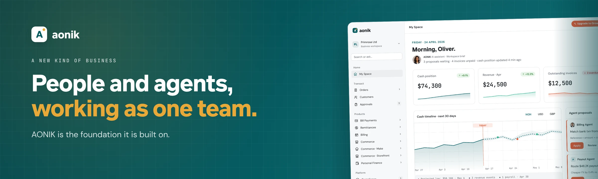

A new kind of business is taking shape, one where people and agents work side by side.
AONIK is the foundation for it: one system for customers, money and operations, where agents
carry the routine, people bring the judgement, and every decision that matters stays with a
person.

The first modules are in finance, from personal finance and payment collection to an online
store and the purchasing, stock and production behind a food business.

[](https://github.com/michaeljosiah/aonik/actions/workflows/ci.yml)
[](global.json)
[](LICENSE)

**[Foundation](#the-foundation-and-what-is-built-on-it) · [Agents](#meet-the-agents) · [Approvals](#nothing-moves-without-a-decision) · [Chat](#one-chat-for-people-and-agents) · [Workflows](#workflows-you-can-read) · [Money](#money-end-to-end) · [Remittance](#remittance) · [Commerce](#commerce) · [Publishing](#publishing) · [Voice](#voice) · [Observe](#see-what-happened) · [Payabo](#payabo) · [Run it](#run-from-source)**

</div>

---

## What's new

- **Workflows with governed decisions.** A workflow is a graph you can read. Decision tables
  route each case to an action and a named reviewer, and a flow can call child flows, loop
  over a collection, branch in parallel, wait, and stop for a person. [See it →](#workflows-you-can-read)
- **Workflows that start themselves.** A published version can start from an invoice event, a
  schedule or a Gmail message, and run under an automation identity scoped to exactly the
  actions it was granted. [See it →](#workflows-you-can-read)
- **Connectors, starting with Gmail.** Search and read, draft, label, send. Each action sits
  behind platform policy, workspace policy, the mailbox owner's consent and its own approval. [See it →](#connectors)
- **Documents become invoices.** A scanned or emailed bill is read with OCR, held as a
  candidate, and becomes an invoice only when a person confirms it. [See it →](#connectors)
- **Approvals that follow you.** The same approval card appears in chat, shared rooms, the
  playground and workflow reviews, and a voice session hands you a link to the exact request. [See it →](#nothing-moves-without-a-decision)
- **Shared chat rooms.** People and agents in one conversation, with mentions, presence and an
  inbox. [See it →](#one-chat-for-people-and-agents)
- **Publishing for Arke.** A creator submits a finished edition from Arke Studio, an editor
  approves one exact revision, and Arke Player picks it up from the catalogue. [See it →](#publishing)
- **Receipts for transfers.** Send, resend and track a remittance receipt, with a bounced
  address corrected before another copy goes. [See it →](#remittance)
- **Five business types.** General, Remittance, Food Commerce, Personal Finance and Arke Worlds
  each ship as a pack. [See it →](#one-platform-many-products)

## The idea

For thirty years software gave a business tools, and its people did all of the work with
them. Every new need meant another application: one for invoices, one for customers, one for
the shop, one for support, each with its own login and its own version of the truth.

Agents change that. So far they have arrived in two ways: as an assistant bolted onto each of
those applications, seeing a tenth of the business, or as automation meant to run without the
people who understand the business.

AONIK takes a third way. **People and agents work as one team**, on one system that holds the
record. Agents take the work that is repetitive and constant: drafting invoices, classifying
transactions, checking stock, preparing the purchase order. People do what people are for:
judgement, relationships, and the decisions that carry weight. Each agent has a role, tools
and limits, and works in the open, where its colleagues can see what it did and why.

It is a new kind of business, and it suits any size. A larger team hands the routine to agents
and spends its time on customers and decisions. A founder working alone gains colleagues. In
both, an agent proposes and a person decides, so what a company can take on is no longer set
by the hours in its people's day.

<div align="center">

<picture>
  <source media="(prefers-color-scheme: dark)" srcset=".github/assets/readme-my-space-dark.webp">
  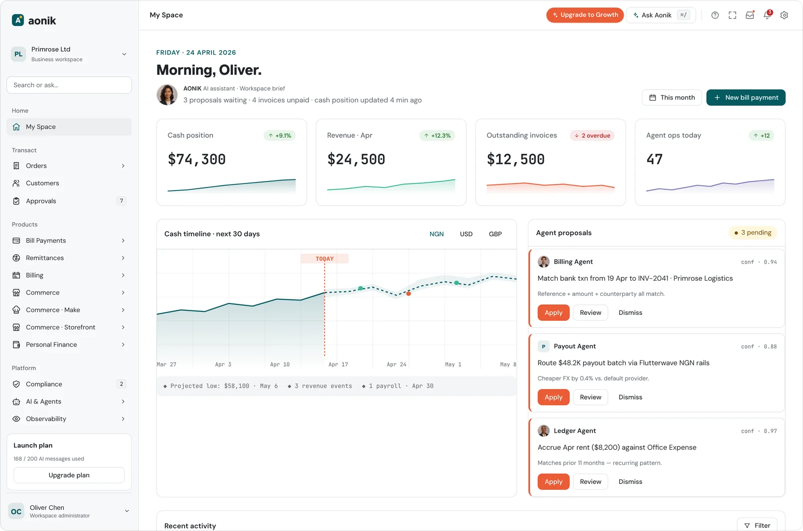
</picture>

*My Space: the day's position, and what the agents would like to do about it. Each proposal
waits for Apply, Review or Dismiss.*

</div>

## The foundation, and what is built on it

AONIK is one foundation with modules on top. The foundation is what every business needs,
whatever it sells:

| | |
|---|---|
| **Customers** | One record for each person or business you deal with: profile, contacts, relationships, consent and preferences, documents, and what they have ordered across every module. |
| **Reaching them** | Enquiries, sign-up lists with unsubscribe, content and media for your site, message templates, and email, SMS and push. Discounts, gift cards and loyalty for a shop. |
| **Money** | Orders, invoices, payments and a double-entry ledger that every module shares. |
| **Documents** | Files with versions, links to the records they belong to, extraction and search. |
| **People and access** | Sign-in, roles, permissions and sessions, with a workspace for each business. |
| **Compliance** | Identity documents and their verification, screening checks, cases and an audit record. |
| **Agents and automation** | Agents that work alongside your team, with approvals, workflows, connectors, chat and voice. |

The first modules built on it follow the money outward, from one person's finances to a
working kitchen:

| | |
|---|---|
| **Personal finance** | Accounts and transactions, bills, budgets and a plan for a household. This is what Payabo runs on. |
| **Payment collection** | Invoices, customer accounts, allocations and dunning plans, bill payments, and online checkout. |
| **Cross-border transfers** | Corridors, FX rates, payout partners, beneficiaries and receipts. |
| **An online store** | A catalogue, baskets, checkout, delivery dates and promotions, behind a public storefront API. |
| **A food business** | Recipes, production orders, ingredients and their costs, suppliers, purchase orders, goods received, stock levels and margins: the work usually handed to an ERP system. |
| **Publishing and subscriptions** | Editions reviewed and released to a catalogue, with plans, entitlements and metered usage. |

A module is switched on, not installed separately. It shares the same customers, the same
ledger and the same agents as every other module, so the customer who bought a meal box and
the customer who owes an invoice are one record. New kinds of business arrive as a
[pack](#one-platform-many-products) of configuration, and no product's name belongs in
platform code.

## Three mechanics

The rest of the platform follows from these.

**1. Agents propose; systems execute.** Every tool that can change something is classified by
risk before a model is ever offered it. Low-risk writes run with an audit record. Medium-risk
writes wait for a person to approve those exact arguments, once. High-risk actions (moving
money, posting to the ledger, calling a partner) never run inside the conversation: they become
a durable proposal that a dispatcher executes only after approval. A tool that looks mutating
and has no classification stops the agent from loading, so nothing slips through unclassified.

**2. An order is not a payment, and neither is the ledger.** An *Order* records what somebody
asked for. A *PaymentIntent* records how it is funded. The *ledger* is double-entry and
immutable, and is the only thing that says what happened. The three are never collapsed,
whether the order is a bill payment, a transfer or a box of jollof rice.

**3. A product is a configuration.** A tenant carries a business type, and provisioning applies
the pack for it: modules, settings, agent overrides and reference data, as data rather than
code. The Admin UI resolves its navigation and labels from the same type, so a food business
sees *Menu* where a remittance desk sees *Transfer orders*.

## Core concepts

| | |
|---|---|
| **Tenant** | A workspace. Every request is scoped to one, and every entity carries its tenant. |
| **Party** | A person or a business, with profile, KYC or KYB, documents and relationships. Customers, beneficiaries and suppliers are all parties. |
| **Order** | The canonical record of a requested transaction: a bill payment, a money transfer, a payout, a remittance or a product purchase. The type decides what the line items hold. |
| **Payment** | How an order is funded or executed. Always a `PaymentIntent`, whatever the order type. |
| **Ledger** | Double-entry and immutable. Journal entries, a chart of accounts, balances. The financial truth. |
| **Agent** | A domain specialist with its own instructions, model and tools, built on Microsoft Agent Framework. An orchestrator routes each request to the right ones. |
| **Tool approval** | A single-use approval for one medium-risk action, bound to a hash of the arguments, the requester, the tenant and an expiry. |
| **Proposal** | The durable record of a high-risk action. Nothing happens until it is approved, and then a dispatcher executes it, not the agent. |
| **AiRun** | One model invocation, recorded with its tokens, estimated cost and latency. Anything an agent caused points back to one. |
| **Workflow** | A versioned graph of triggers, tools, agents, decisions, waits and human steps. A published version is immutable. |
| **Pack** | The configuration for a business type: enabled modules, settings, agent overrides, reference data. |
| **Workspace** | A versioned tree of files owned by a party, with content-addressed blobs and a sync protocol. |

## How it works

Every agent-driven change follows one path:

```
  a request, a schedule or an event ──▶ an agent plans ──▶ a tool call ──▶ the approval gate
                                                                               │
     low     runs now, with an audit record  ◀─────────────────────────────────┤
     medium  waits for one person to approve these exact arguments, then runs once
     high    becomes a Proposal ──▶ approved ──▶ the dispatcher executes ──▶ ledger and audit
```

The gate is enforced on the server. An approval is checked for identity, tenant, expiry,
single use and a match on the argument hash, so approving one action never approves a
different one that looks similar.

## Meet the agents

Nine agents are registered today, with an orchestrator in front of them. The orchestrator
exposes each domain agent to the model as a tool, filtered by the modules the tenant has
switched on, and adds memory, document search, reminders, workflow tools and connector tools
of its own.

<div align="center">

<picture>
  <source media="(prefers-color-scheme: dark)" srcset=".github/assets/readme-agents-dark.webp">
  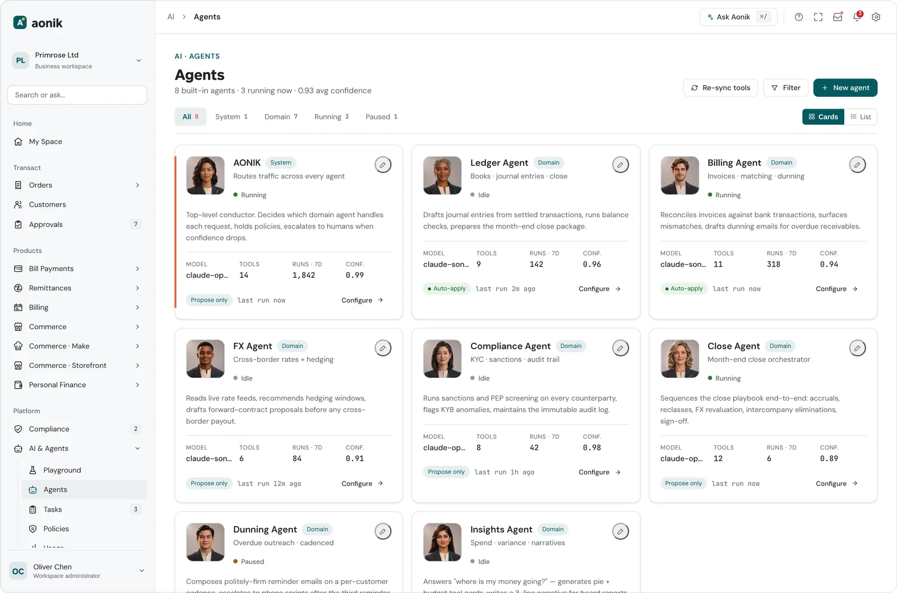
</picture>

*The roster. Each card says what the agent is for, what it runs on, how many tools it holds
and whether it may apply its own work or only propose it.*

</div>

| Agent | What it does |
|---|---|
| `master-orchestrator` | Routes each request to the domain agents the tenant has enabled. Holds memory, document search, reminders, workflow and connector tools. |
| `finance-agent` | Invoices, the ledger and payments. Its money tools are high risk and always become proposals. |
| `commerce-agent` | Catalogue, orders, stock, production and checkout for a shop. |
| `platform-agent` | Tenants, users and compliance. Read-only. |
| `personal-finance-agent` | Accounts, transactions, bills, budgets, commitments and account linking for a household, with memory of what it has been told. |
| `financial-life-graph-agent` | Reads and traverses the graph of a person's accounts, merchants, obligations and relationships. |
| `pf-classify` · `pf-forecast` · `pf-insights` | Sub-agents for classification, forecasting and insight, each able to run generated code in a sandbox. |
| `pf-compass-planner` | Returns a plan as structured output. No tools. |

A tenant can override an agent's instructions, pin its model and narrow its toolset without
touching code. The drawings use illustrative personas (Billing Agent, Ledger Agent, FX Agent)
to show what that looks like in a finance team.

<table>
<tr>
<td width="50%" valign="top">
<picture>
  <source media="(prefers-color-scheme: dark)" srcset=".github/assets/readme-agent-detail-dark.webp">
  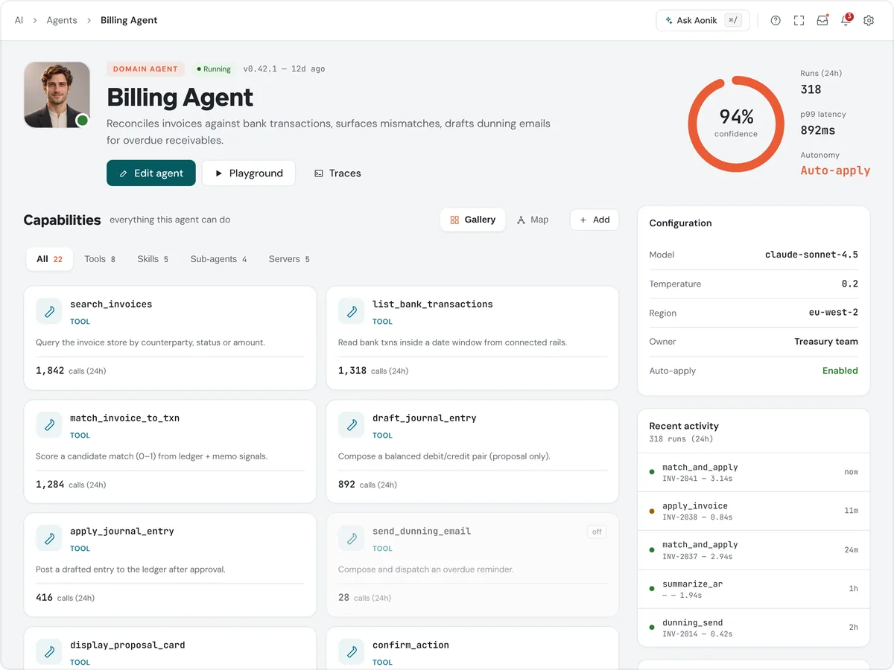
</picture>
<br><b>An agent, in full.</b> What it can call, what it runs on, how autonomous it is, and
what it did in the last day.
</td>
<td width="50%" valign="top">
<picture>
  <source media="(prefers-color-scheme: dark)" srcset=".github/assets/readme-agent-command-center-dark.webp">
  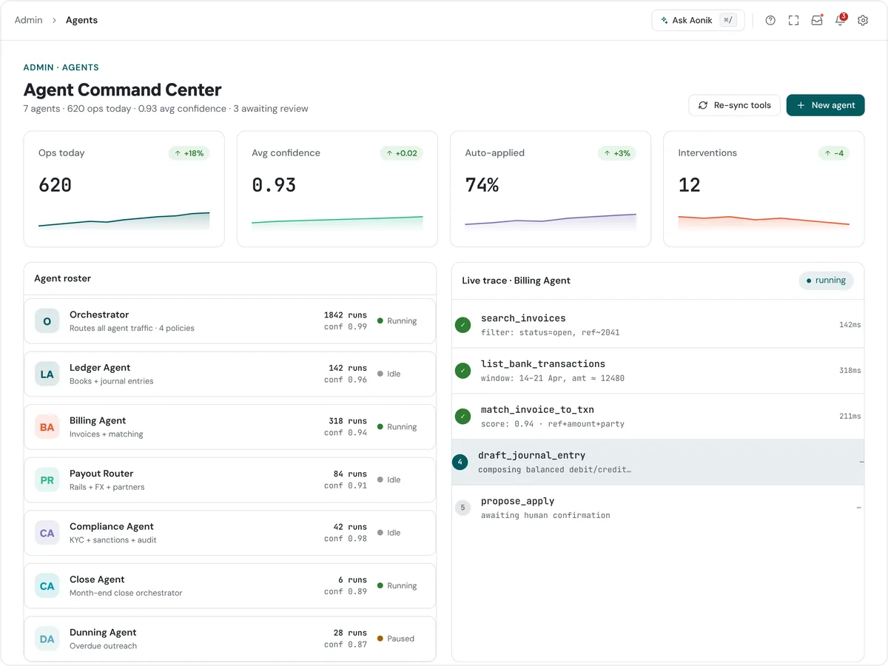
</picture>
<br><b>The command centre.</b> Who is running, what they are calling right now, and which
step is waiting for a person.
</td>
</tr>
<tr>
<td width="50%" valign="top">
<picture>
  <source media="(prefers-color-scheme: dark)" srcset=".github/assets/readme-playground-dark.webp">
  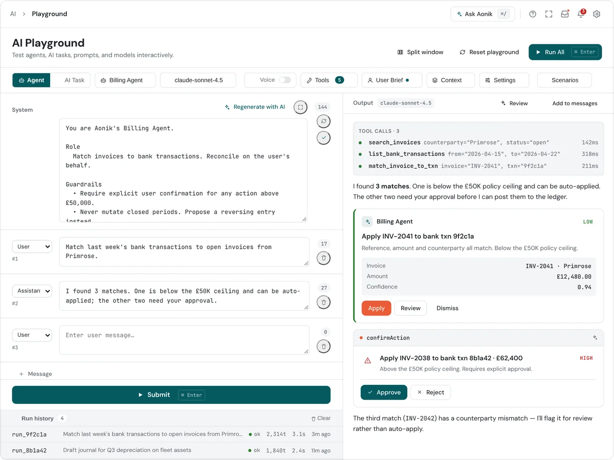
</picture>
<br><b>Playground.</b> Run an agent against a prompt, a model and a toolset. It raises the
same approval cards that production does.
</td>
<td width="50%" valign="top">
<picture>
  <source media="(prefers-color-scheme: dark)" srcset=".github/assets/readme-ai-usage-dark.webp">
  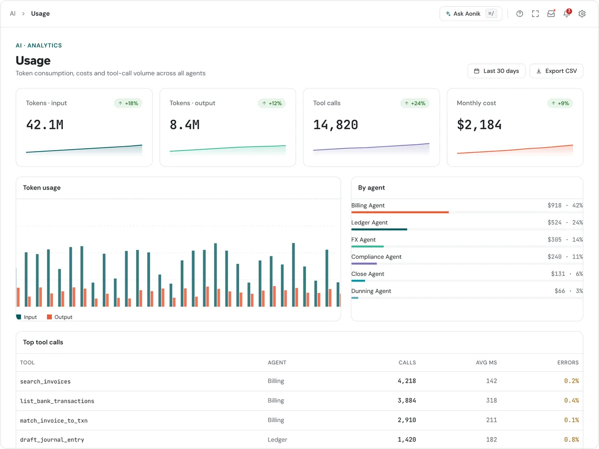
</picture>
<br><b>Usage and cost.</b> Every model call is an <code>AiRun</code> with tokens, an
estimated cost and latency, rolled up by agent and by tool.
</td>
</tr>
</table>

## Nothing moves without a decision

Approvals are one queue across every product: whatever an agent, a workflow or a voice
session has asked to do and is not allowed to do alone. Each request arrives with the exact
action and the record it concerns.

<div align="center">

<picture>
  <source media="(prefers-color-scheme: dark)" srcset=".github/assets/readme-approvals-dark.webp">
  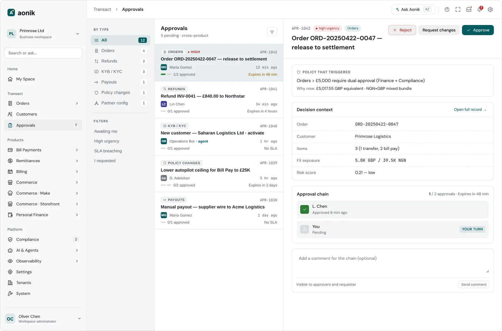
</picture>

*One queue for every decision, each request opened beside its context.*

</div>

<table>
<tr>
<td width="50%" valign="top">
<picture>
  <source media="(prefers-color-scheme: dark)" srcset=".github/assets/readme-proposal-review-dark.webp">
  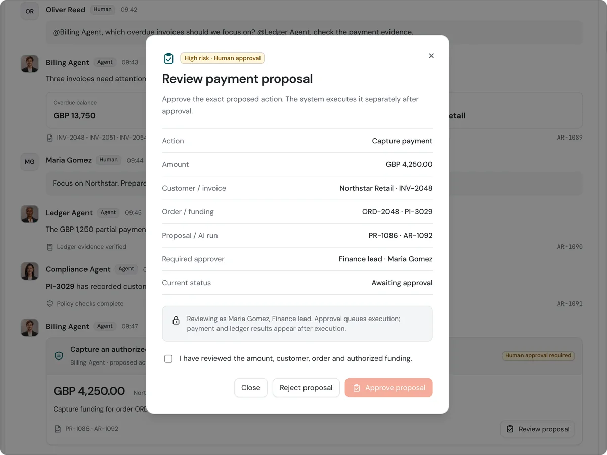
</picture>
<br><b>High risk becomes a proposal.</b> The exact action, its order, its funding and the AI
run that raised it. Approval queues execution; the system carries it out separately.
</td>
<td width="50%" valign="top">
<picture>
  <source media="(prefers-color-scheme: dark)" srcset=".github/assets/readme-approve-once-dark.webp">
  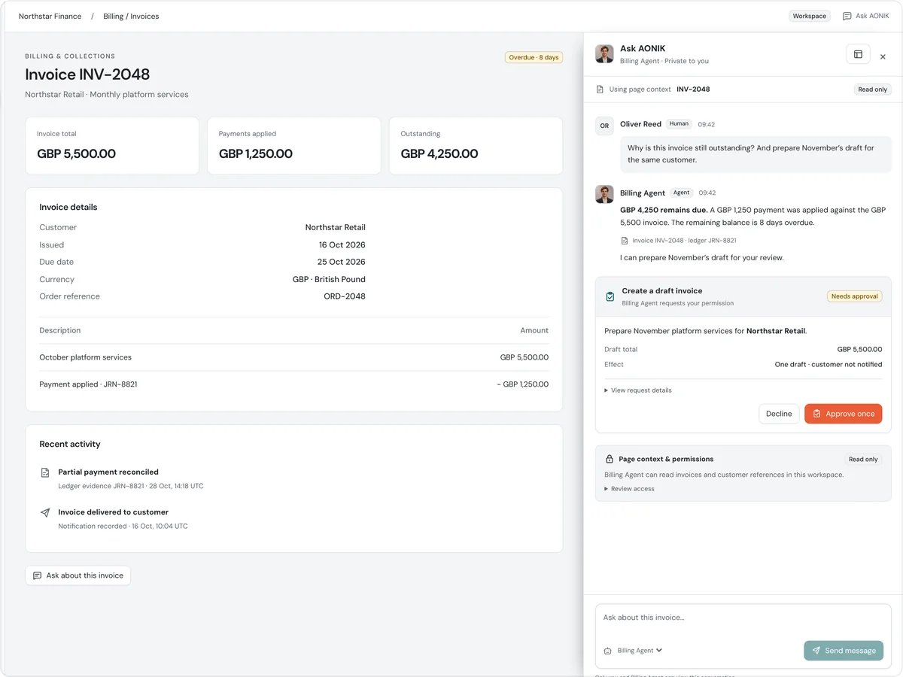
</picture>
<br><b>Medium risk asks once.</b> The agent shows what it will do and what it may read. Your
approval covers that action with those arguments, a single time.
</td>
</tr>
</table>

Decisions are made through `POST /ai/tool-approvals/{id}/decide` and
`POST /ai/proposals/{id}/approve`, and the [CLI](docs/guides/aonik-cli.md) can list, approve
and reject as well. See [Spec 032](docs/specifications/032.tiered-ai-mutation-approval.html)
for the tiers and [Spec 030](docs/specifications/030.proposal-execution-dispatcher.html) for
the dispatcher.

## One chat for people and agents

Ask AONIK opens beside whatever you are working on. A private thread streams over AG-UI. A
shared room puts colleagues and several agents in one conversation, where anyone can be
mentioned and every author is named. An approval raised in a room stays with the person who
asked for the action.

<div align="center">

<picture>
  <source media="(prefers-color-scheme: dark)" srcset=".github/assets/readme-chat-room-dark.webp">
  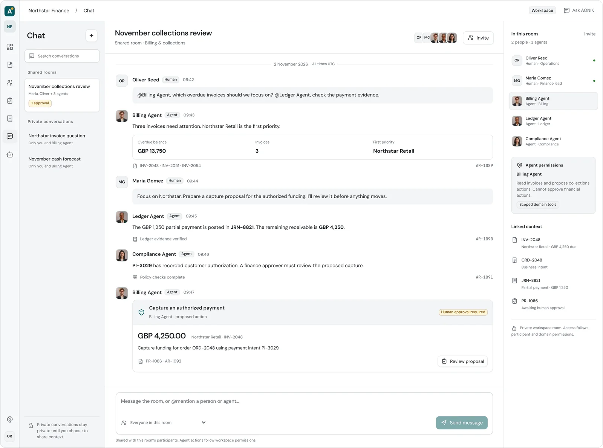
</picture>

*Two people and three agents in one room. The capture at the bottom is a proposal, and
says so.*

</div>

<table>
<tr>
<td width="50%" valign="top">
<picture>
  <source media="(prefers-color-scheme: dark)" srcset=".github/assets/readme-mentions-dark.webp">
  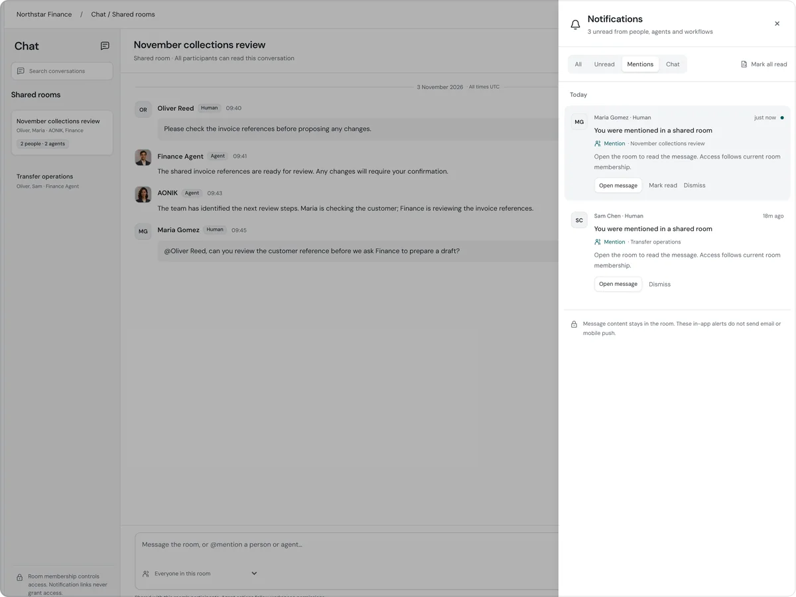
</picture>
<br><b>Mentions.</b> Being named in a room puts the message in your inbox, with a link back
to where it was said.
</td>
<td width="50%" valign="top">
<picture>
  <source media="(prefers-color-scheme: dark)" srcset=".github/assets/readme-notifications-dark.webp">
  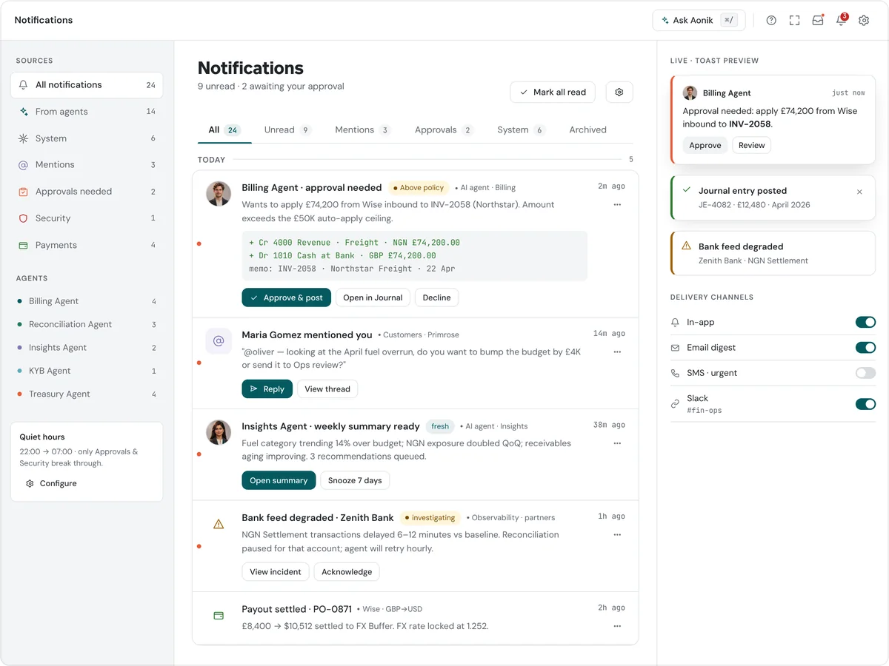
</picture>
<br><b>One inbox.</b> Agents, colleagues, approvals and system events in a single feed you
can filter.
</td>
</tr>
</table>

Rooms, mentions, presence and in-app notifications are covered in
[collaborative chat](docs/features/collaborative-chat.md).

## Workflows you can read

A workflow is a published, versioned graph: Trigger, Tool, Agent, Decision, Human, Wait,
Notify, Emit, Loop, Child, Parallel and End. It runs on Microsoft Agent Framework workflows,
checkpoints as it goes, and resumes after a restart without repeating an effect.

<div align="center">

<picture>
  <source media="(prefers-color-scheme: dark)" srcset=".github/assets/readme-workflow-editor-dark.webp">
  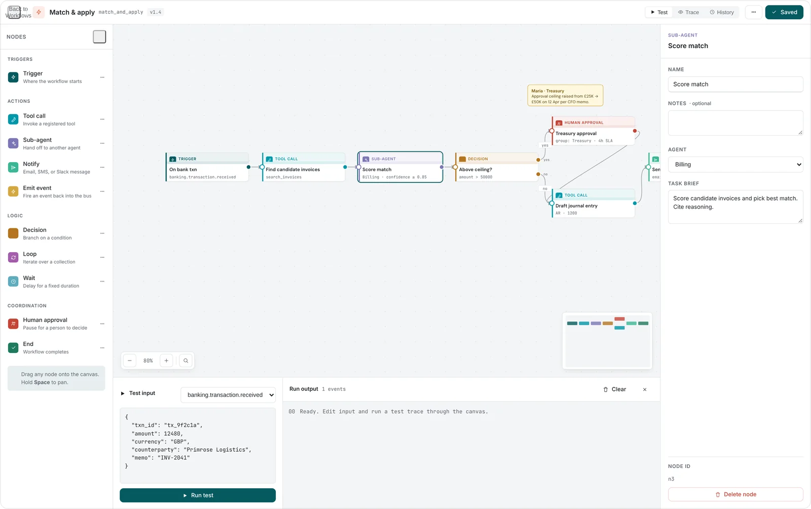
</picture>

*The editor: a palette, the graph, an inspector for the selected step, and a test run
underneath.*

</div>

**Decisions are tables, not prompts.** A Decision node holds a deterministic table that routes
a case to an action and a named reviewer role. Tables can be shared as libraries and pinned
by version. A match never authorises the action: each step still passes its own approval.

**Publishing is itself a decision.** A published version is immutable and hashed. Publishing
or retiring one is a high-risk proposal, as is switching a trigger on.

**They start on their own, within limits.** Triggers are manual, an invoice being created or
issued, a schedule in a named time zone, or a Gmail message arriving. A run is bounded: one
hundred loop iterations, four parallel branches, five levels of nesting, seven days.
Execution is off until a workspace turns it on.

<table>
<tr>
<td width="50%" valign="top">
<picture>
  <source media="(prefers-color-scheme: dark)" srcset=".github/assets/readme-workflows-dark.webp">
  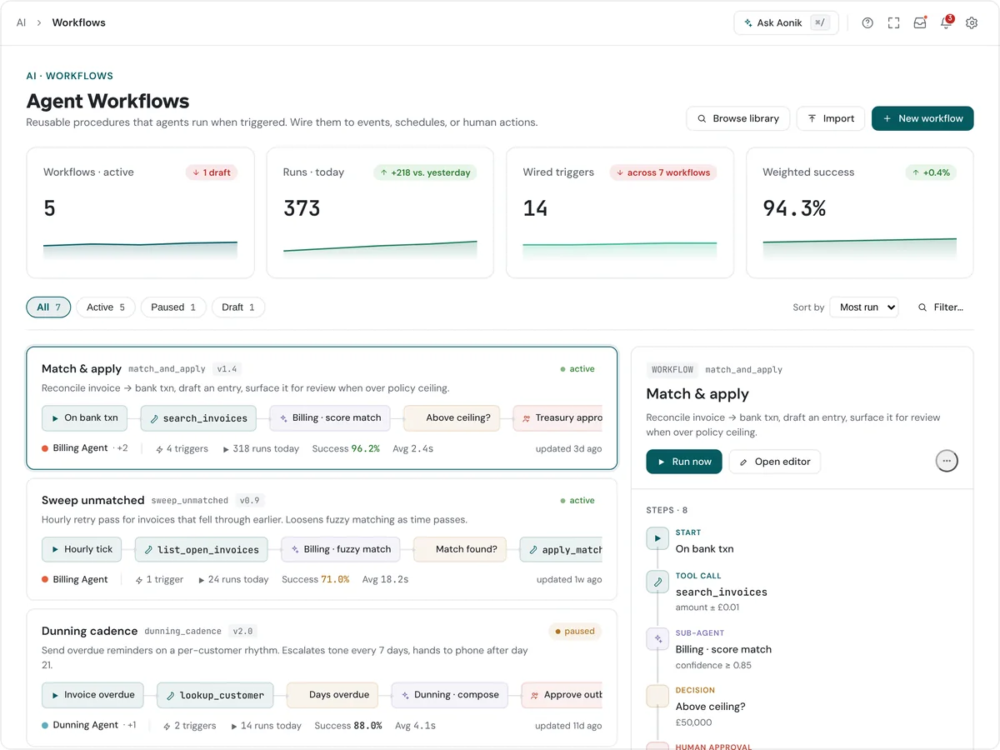
</picture>
<br><b>Reusable procedures.</b> Each workflow reads as its steps, with its triggers, run
count and success rate.
</td>
<td width="50%" valign="top">
<picture>
  <source media="(prefers-color-scheme: dark)" srcset=".github/assets/readme-extensions-dark.webp">
  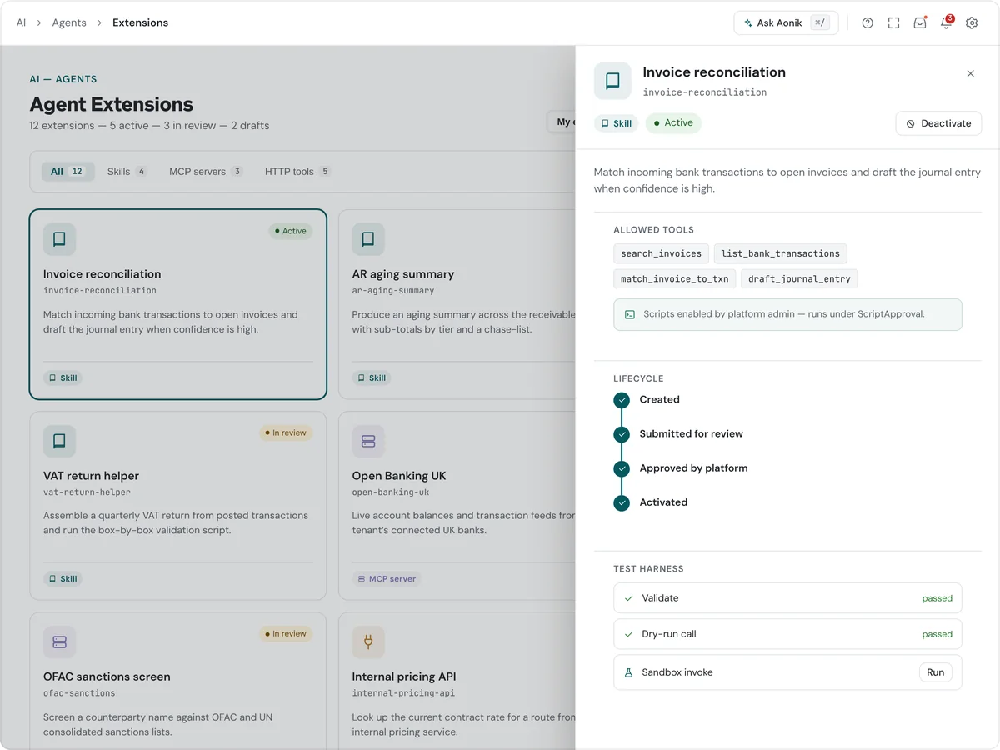
</picture>
<br><b>Extensions.</b> A tenant adds skills, HTTP tools and MCP servers of its own, each
with a declared set of allowed tools.
</td>
</tr>
</table>

### Connectors

Gmail is the first native connector: search, read and fetch attachments; create drafts,
label, archive and restore with a medium approval; send, reply, forward and delete for good
only as high-risk proposals. Access is a chain, and every link has to hold: platform policy,
workspace policy, a connection request, the mailbox owner's consent, then explicit grants
for named actions.

Mail can feed work. An approved Gmail source admits attachments into Documents, each one is
scanned for malware and read with OCR, and a financial document becomes a reviewed candidate
that a person confirms into an invoice. Beyond Gmail, a curated catalogue installs signed MCP and
HTTP connector packages after platform review.

Partner payment connectors are a separate framework inside Finance:
[Flutterwave](src/Aonik.Finance/Services/Partners/Connectors) payouts and bill payments, and
Stripe Checkout, with a simulated partner for development.

### Teach an agent something new

An extension goes through the same lifecycle as anything else that could act: declared,
submitted, reviewed by a platform administrator, activated. Its tools are classified by risk
like built-in ones, so a tenant's own HTTP tool that writes somewhere is gated exactly as
`CapturePayment` is.

<table>
<tr>
<td width="50%" valign="top">
<picture>
  <source media="(prefers-color-scheme: dark)" srcset=".github/assets/readme-extension-harness-dark.webp">
  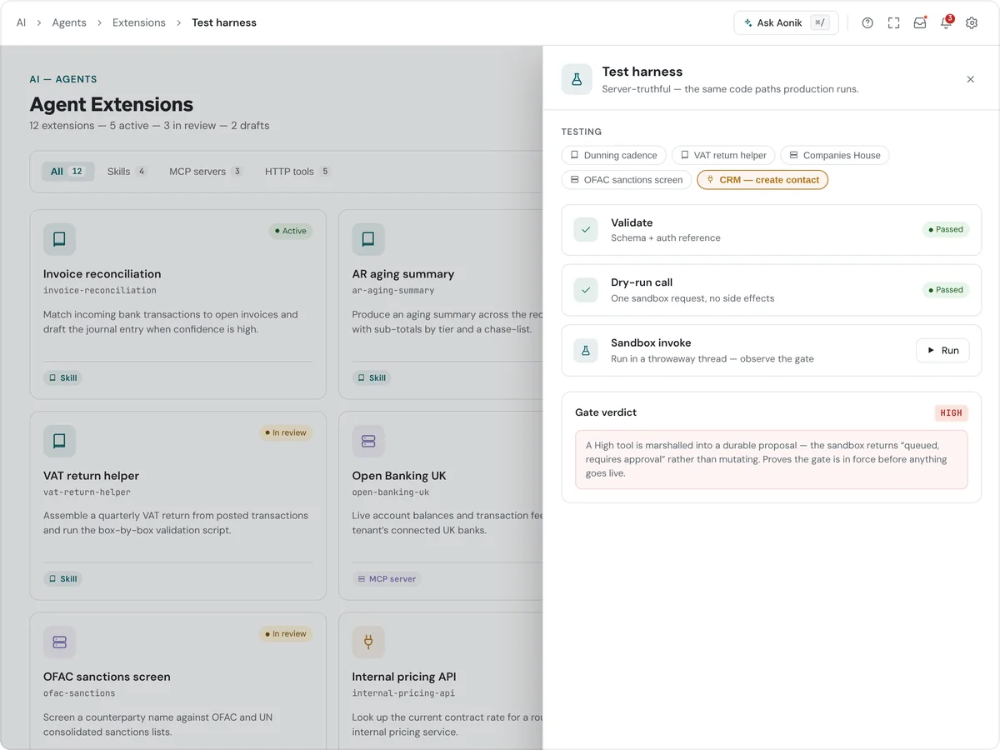
</picture>
<br><b>Test before it is trusted.</b> Validate the schema, dry-run a call, then invoke it in
a sandbox and watch what the gate does with it.
</td>
<td width="50%" valign="top">
<picture>
  <source media="(prefers-color-scheme: dark)" srcset=".github/assets/readme-extension-review-dark.webp">
  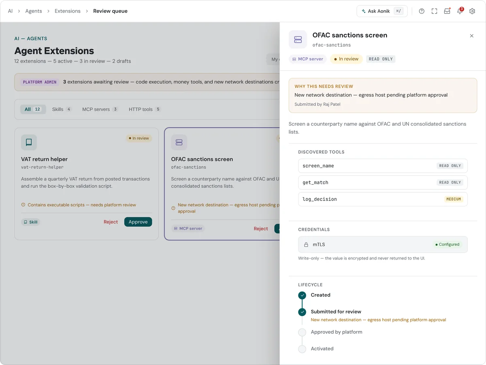
</picture>
<br><b>Reviewed by the platform.</b> Code execution, money tools and new network
destinations wait for a platform administrator.
</td>
</tr>
</table>

See [Spec 099](docs/specifications/099.decision-matrix-and-agent-workflows.html) for
decisions and workflows, [Spec 033](docs/specifications/033.tenant-managed-agent-extensibility.html)
for extensions, and the [operator runbook](docs/runbooks/decision-workflows.md).

## Money, end to end

`Aonik.Ordering` holds the order spine. `Aonik.Finance` builds the money on top of it:
invoices and allocations, payment intents and capture, a double-entry ledger, fees and FX,
and the partners that carry a payment to its destination.

<div align="center">

<picture>
  <source media="(prefers-color-scheme: dark)" srcset=".github/assets/readme-create-order-dark.webp">
  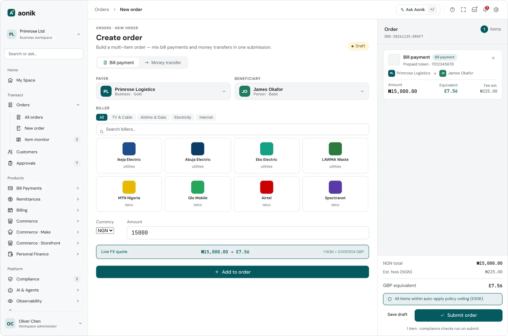
</picture>

*Bill payments and money transfers are items on the same order, quoted before it is
submitted.*

</div>

<table>
<tr>
<td width="50%" valign="top">
<picture>
  <source media="(prefers-color-scheme: dark)" srcset=".github/assets/readme-order-list-dark.webp">
  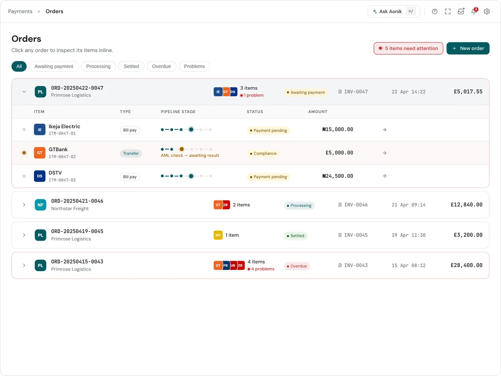
</picture>
<br><b>Orders open into their items.</b> Each line shows its own stage and what is
holding it.
</td>
<td width="50%" valign="top">
<picture>
  <source media="(prefers-color-scheme: dark)" srcset=".github/assets/readme-order-item-dark.webp">
  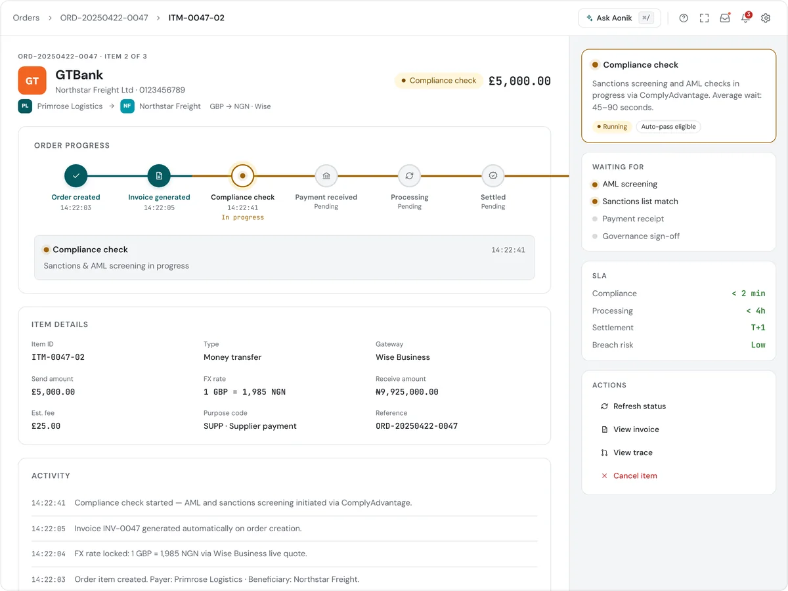
</picture>
<br><b>One item, start to finish.</b> Created, invoiced, checked, funded, processed,
settled, with the activity underneath.
</td>
</tr>
<tr>
<td width="50%" valign="top">
<picture>
  <source media="(prefers-color-scheme: dark)" srcset=".github/assets/readme-invoices-dark.webp">
  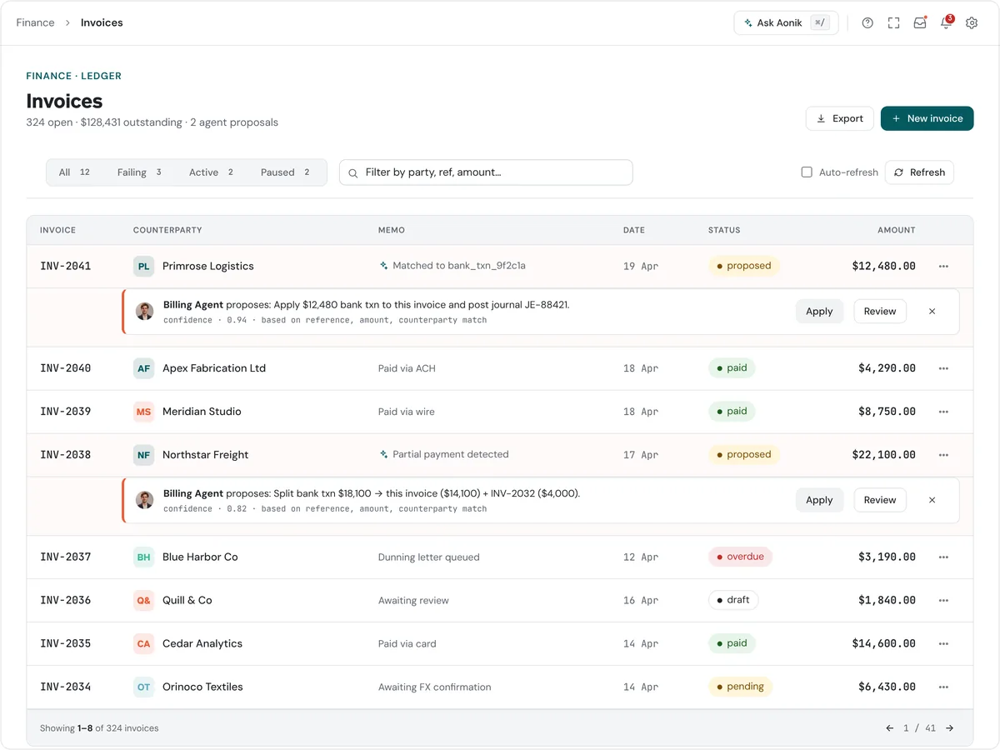
</picture>
<br><b>Proposals arrive inside the work.</b> A suggested match sits on the invoice it
concerns, with its confidence and what it was based on.
</td>
<td width="50%" valign="top">
<picture>
  <source media="(prefers-color-scheme: dark)" srcset=".github/assets/readme-journal-dark.webp">
  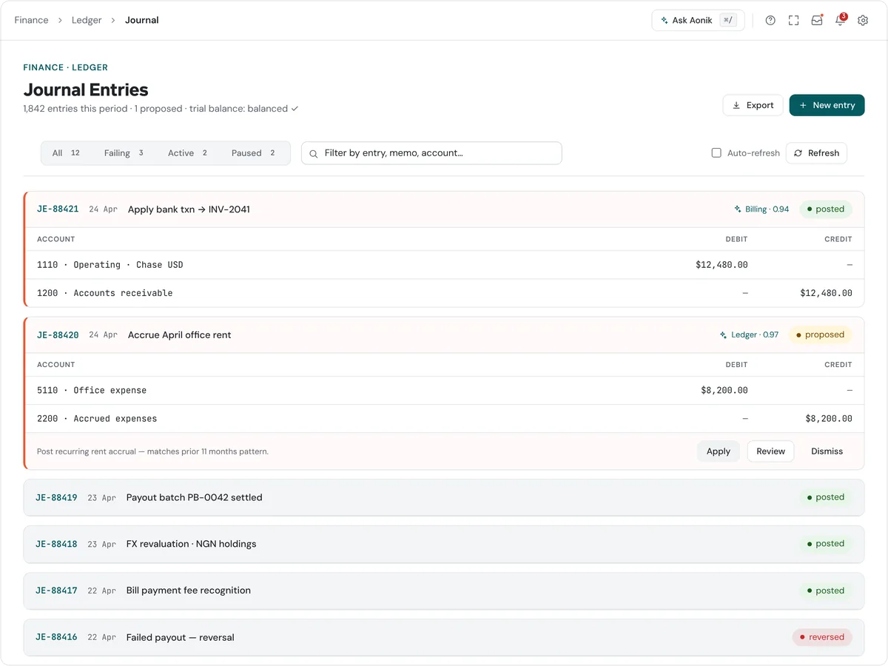
</picture>
<br><b>Posted and proposed, side by side.</b> Entries balance. An agent's entry is marked
as proposed until someone applies it.
</td>
</tr>
<tr>
<td width="50%" valign="top">
<picture>
  <source media="(prefers-color-scheme: dark)" srcset=".github/assets/readme-accounts-dark.webp">
  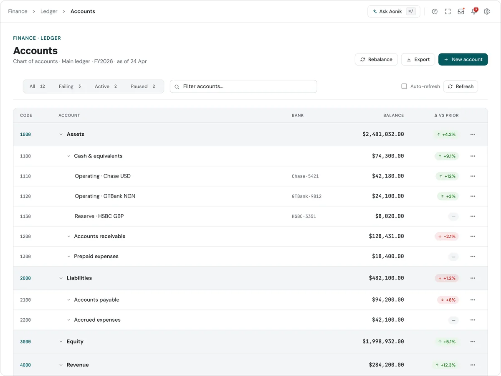
</picture>
<br><b>Chart of accounts.</b> Assets, liabilities, equity and revenue, with balances from
the ledger.
</td>
<td width="50%" valign="top">
<picture>
  <source media="(prefers-color-scheme: dark)" srcset=".github/assets/readme-customer-dark.webp">
  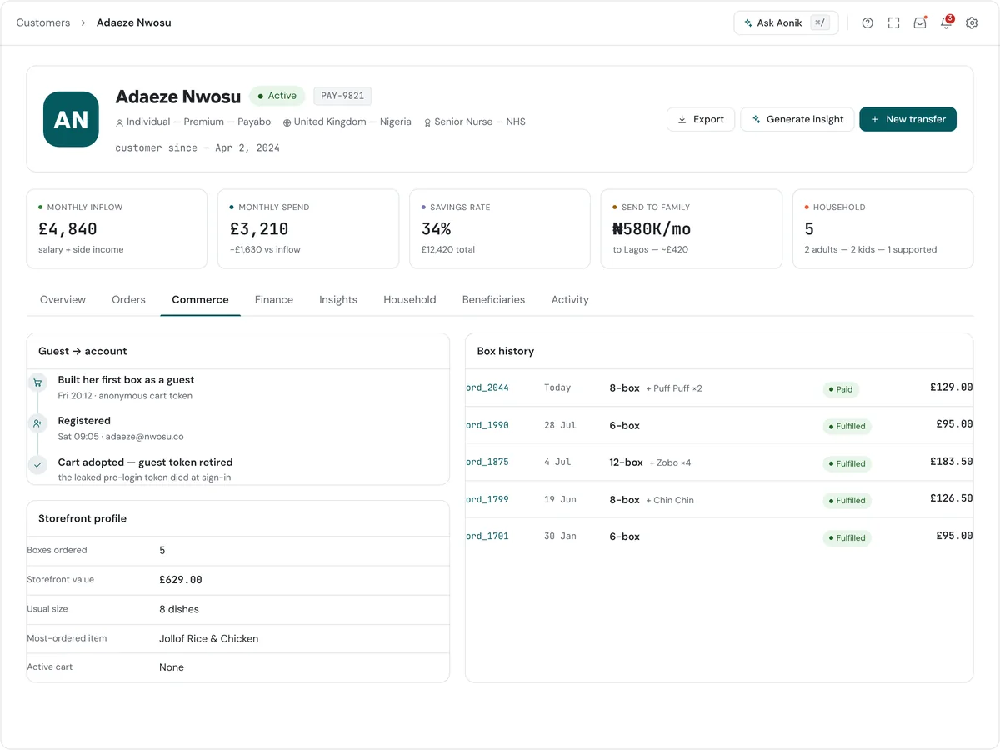
</picture>
<br><b>One customer, every product.</b> Orders, purchases, finance, documents and
activity for the same party in one record.
</td>
</tr>
</table>

Every money-touching path (quote, confirm, capture, transmit, settle, webhook) logs at entry
and at outcome and opens a trace span, so an operator can follow one order through all of
them from `GET /admin/observability/money-actions/{OrderId}`. The convention is in
[money-action logging](docs/observability/money-action-logging.md). Feature guides:
[ledger](docs/features/ledger.md), [billing](docs/features/billing.md),
[payments](docs/features/payments.md), [pricing](docs/features/pricing.md).

## Remittance

A remittance desk is the Finance module under a different profile: transfer orders,
beneficiaries, corridors, partners, FX and the ledger, with compliance and approvals beside
them.

<div align="center">

<picture>
  <source media="(prefers-color-scheme: dark)" srcset=".github/assets/readme-corridors-dark.webp">
  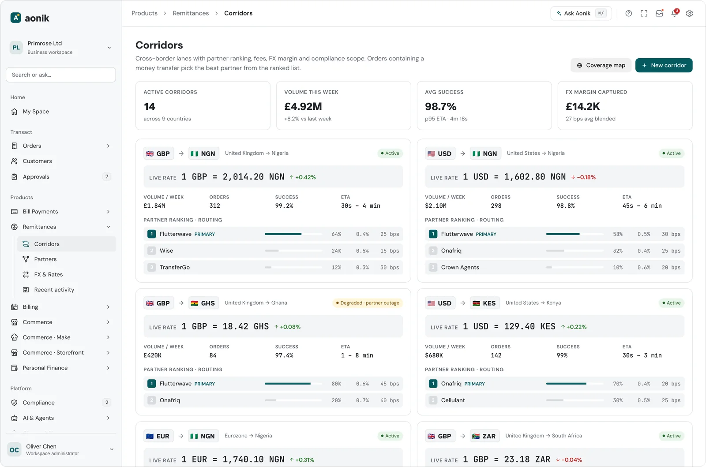
</picture>

*Each corridor with its live rate, its volume and the partners ranked to carry it.*

</div>

<table>
<tr>
<td width="50%" valign="top">
<picture>
  <source media="(prefers-color-scheme: dark)" srcset=".github/assets/readme-transfer-dark.webp">
  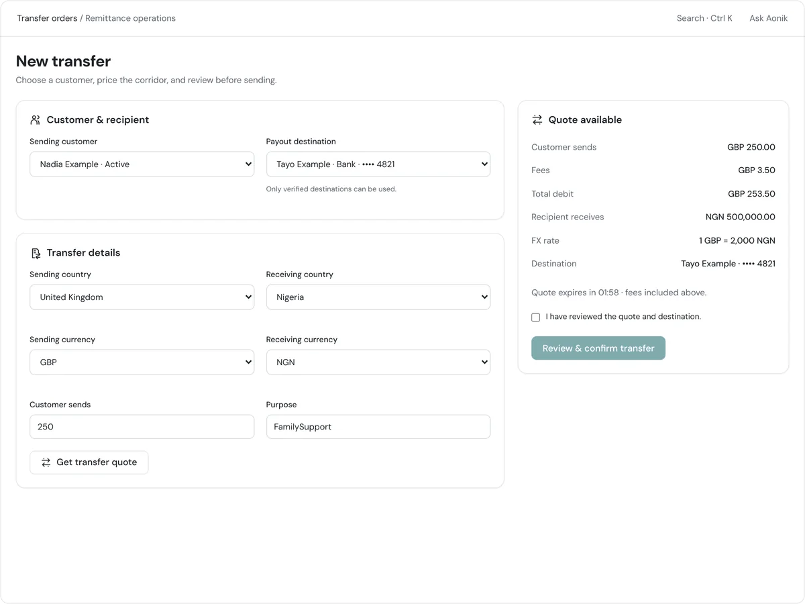
</picture>
<br><b>Priced before it is confirmed.</b> A saved customer, a verified destination, and a
quote with its fees and its expiry.
</td>
<td width="50%" valign="top">
<picture>
  <source media="(prefers-color-scheme: dark)" srcset=".github/assets/readme-beneficiaries-dark.webp">
  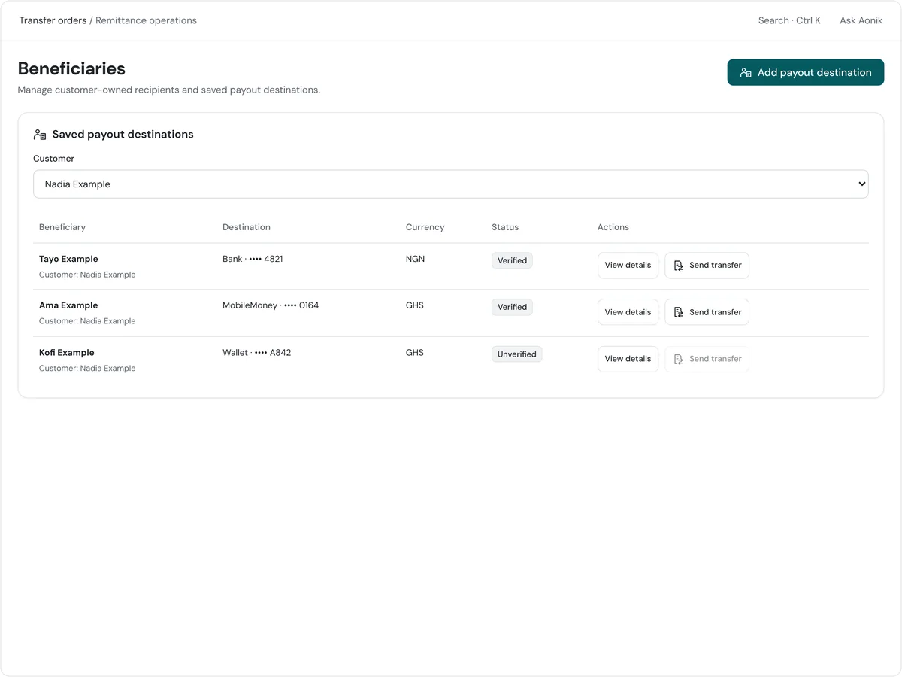
</picture>
<br><b>Saved payout destinations.</b> Bank, mobile money and wallet, verified before a
transfer can use them.
</td>
</tr>
<tr>
<td width="50%" valign="top">
<picture>
  <source media="(prefers-color-scheme: dark)" srcset=".github/assets/readme-fx-rates-dark.webp">
  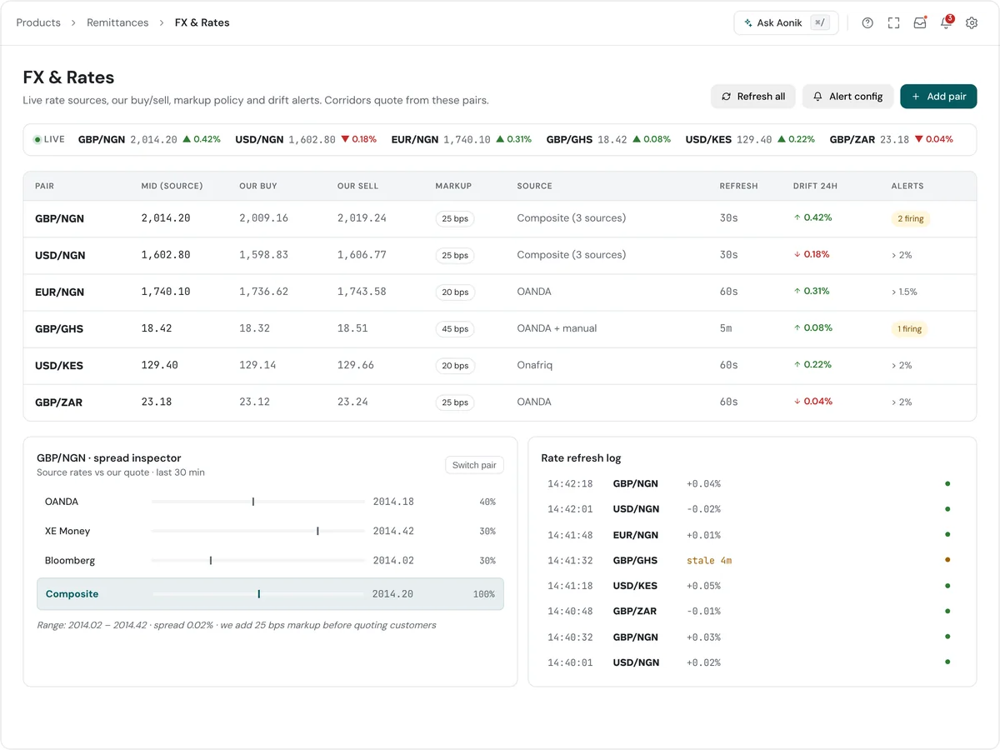
</picture>
<br><b>Rates you can explain.</b> Source rates, your buy and sell, and the markup applied
before a customer is quoted.
</td>
<td width="50%" valign="top">
<picture>
  <source media="(prefers-color-scheme: dark)" srcset=".github/assets/readme-receipts-dark.webp">
  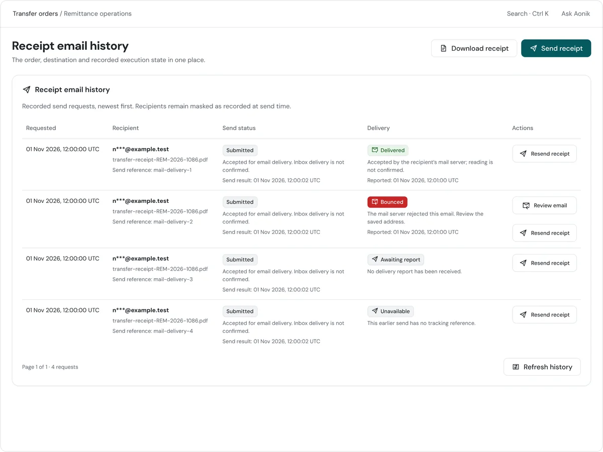
</picture>
<br><b>Receipts that are tracked.</b> Every send is recorded with its outcome, and a
bounced address is corrected before another copy goes.
</td>
</tr>
<tr>
<td width="50%" valign="top">
<picture>
  <source media="(prefers-color-scheme: dark)" srcset=".github/assets/readme-partner-network-dark.webp">
  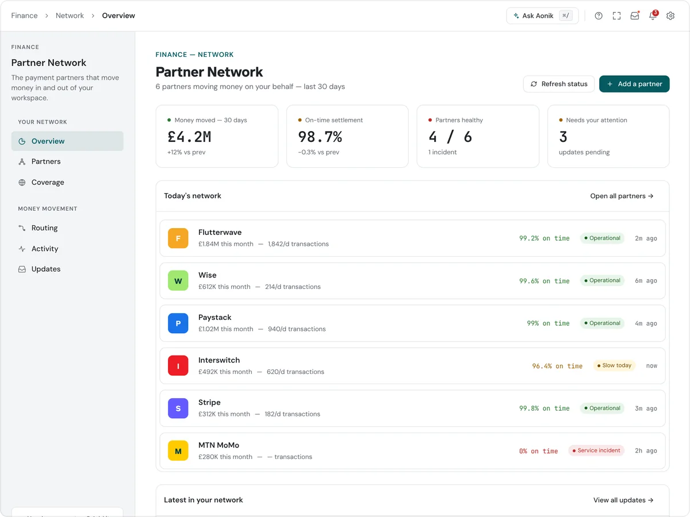
</picture>
<br><b>The partner network.</b> Who is moving money for you, how reliably, and what needs
attention.
</td>
<td width="50%" valign="top">
<picture>
  <source media="(prefers-color-scheme: dark)" srcset=".github/assets/readme-partner-routing-dark.webp">
  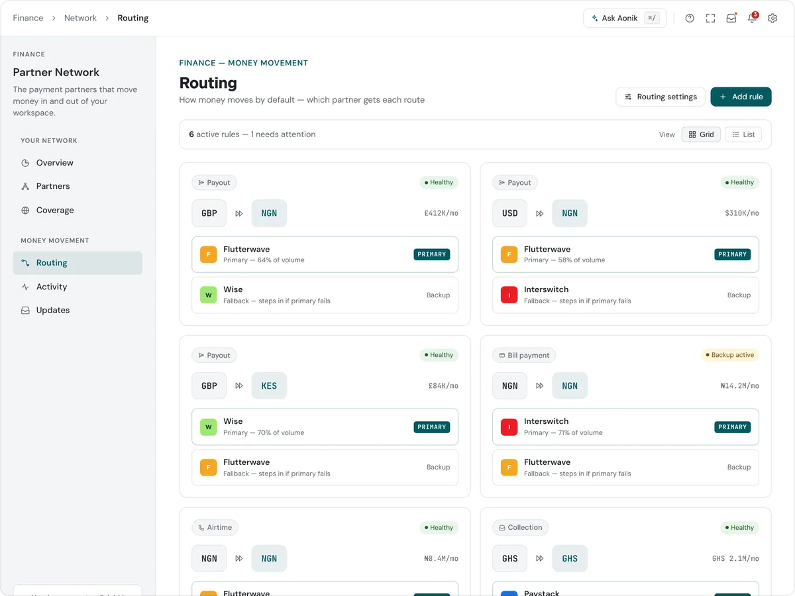
</picture>
<br><b>Routing.</b> A primary and a fallback partner for every route.
</td>
</tr>
</table>

## Commerce

The same order spine sells food. `Aonik.Commerce` adds a catalogue, carts, checkout,
fulfilment, inventory, production, promotions and sourcing, with a public storefront API. A
`ProductPurchase` order is billed through an invoice and funded through a PaymentIntent,
exactly as a transfer is.

<div align="center">

<picture>
  <source media="(prefers-color-scheme: dark)" srcset=".github/assets/readme-food-overview-dark.webp">
  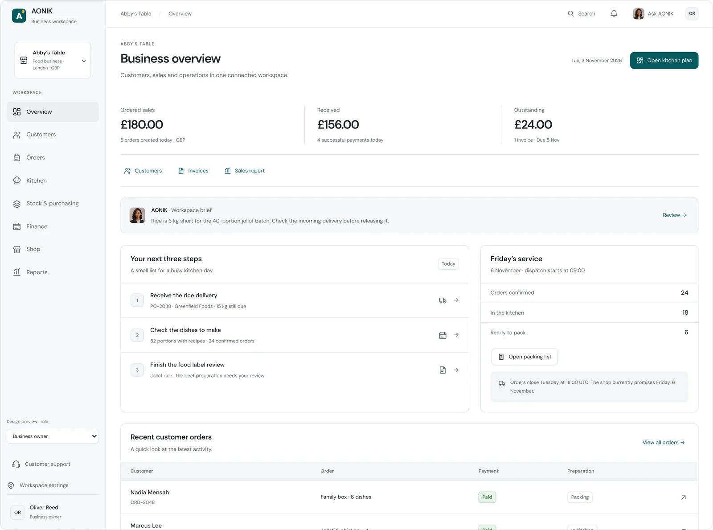
</picture>

*A food business on AONIK: what was ordered, what was paid, and the three things the kitchen
should do next.*

</div>

<table>
<tr>
<td width="50%" valign="top">
<picture>
  <source media="(prefers-color-scheme: dark)" srcset=".github/assets/readme-food-orders-dark.webp">
  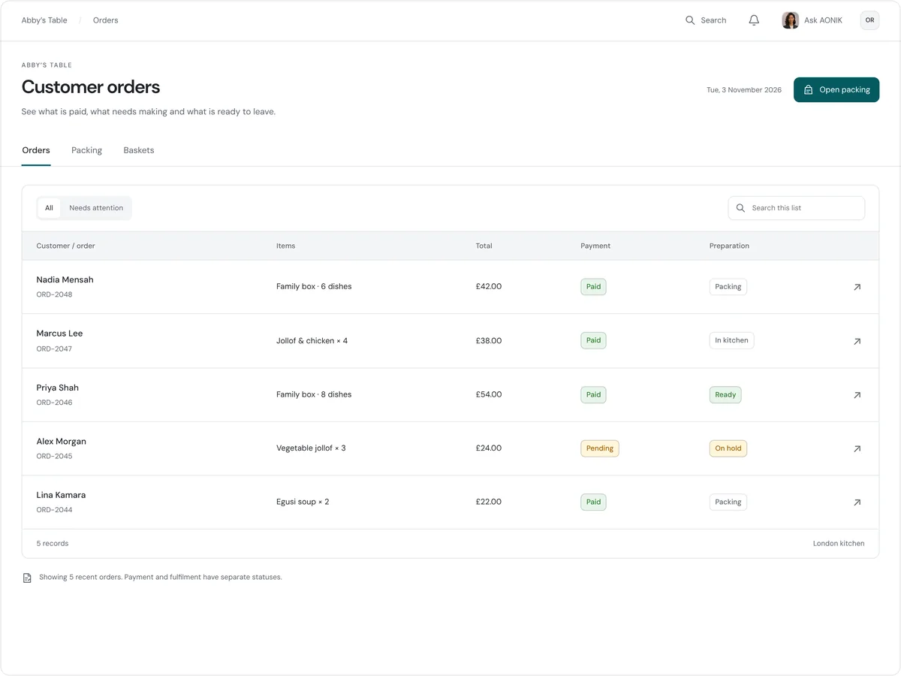
</picture>
<br><b>Customer orders.</b> What is paid, what needs making and what is ready to leave.
Payment and preparation keep separate statuses.
</td>
<td width="50%" valign="top">
<picture>
  <source media="(prefers-color-scheme: dark)" srcset=".github/assets/readme-food-kitchen-dark.webp">
  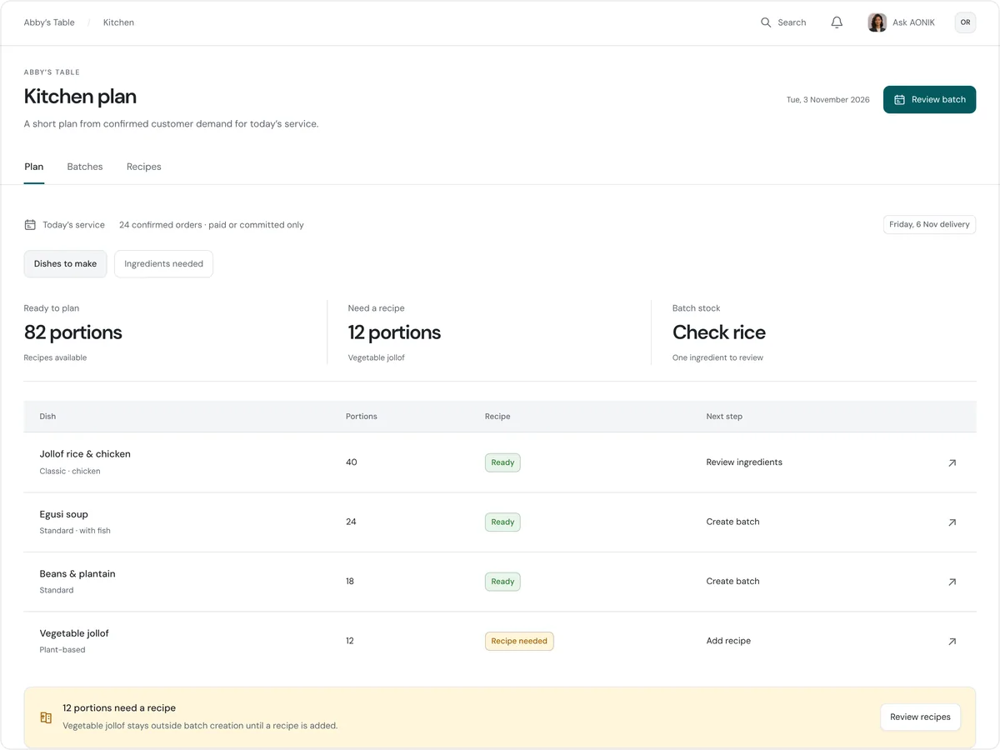
</picture>
<br><b>Kitchen plan.</b> Confirmed demand turned into portions and batches, with the dish
that still needs a recipe called out.
</td>
</tr>
<tr>
<td width="50%" valign="top">
<picture>
  <source media="(prefers-color-scheme: dark)" srcset=".github/assets/readme-food-menu-dark.webp">
  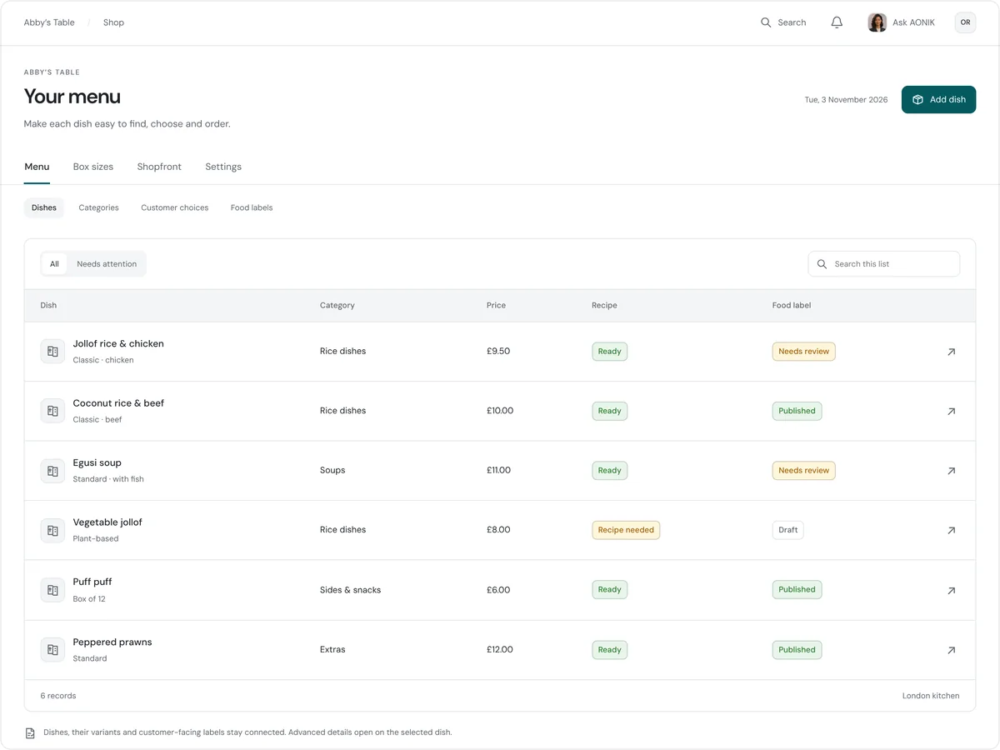
</picture>
<br><b>Your menu.</b> Dishes, categories, customer choices and food labels.
</td>
<td width="50%" valign="top">
<picture>
  <source media="(prefers-color-scheme: dark)" srcset=".github/assets/readme-food-margins-dark.webp">
  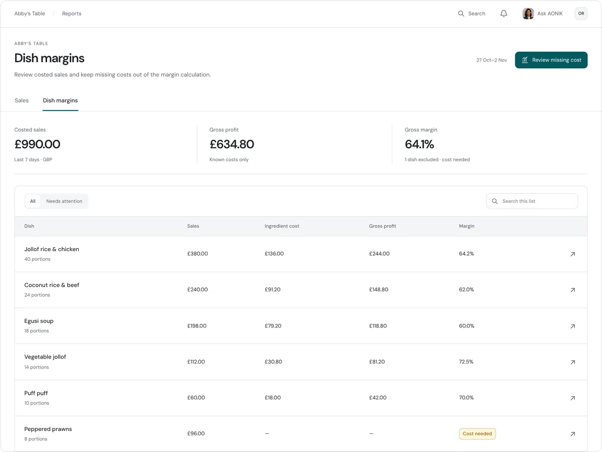
</picture>
<br><b>Dish margins.</b> Sales against ingredient cost. A dish with a missing cost is left
out and named, not estimated.
</td>
</tr>
</table>

The orders, packing, menu, box plan and delivery screens are in the Admin UI today. The
kitchen and margin views are drawn against production, sourcing and reporting APIs that
already exist.

## Publishing

`Aonik.Publishing` takes a finished edition from a creator to a public catalogue, through an
editor. It was built for [Arke](https://github.com/michaeljosiah/ArkeStudio): a creator
submits from Arke Studio, and Arke Player reads what was approved.

<div align="center">

<picture>
  <source media="(prefers-color-scheme: dark)" srcset=".github/assets/readme-publishing-review-dark.webp">
  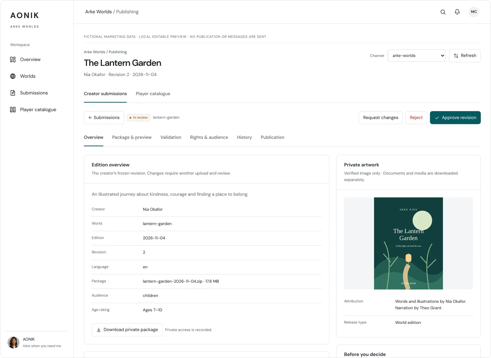
</picture>

*An editor reviews one frozen revision: what it is, who made it, who it is for, and the
package itself.*

</div>

- **Upload in parts.** A package arrives in resumable chunks and survives an interrupted
  connection.
- **Verified in isolation.** A verifier opens the package in a sandbox before anyone
  reviews it: Docker locally, Azure Container Apps dynamic sessions when deployed.
- **One exact revision.** Approval names a revision by its digest. If it changed since you
  opened it, the approval is refused, and a creator cannot review their own submission.
- **Published bytes are the reviewed bytes.** Publication copies them to immutable storage and
  moves the channel catalogue forward. Withdrawal removes an edition from discovery without
  taking it from readers who already hold it.

<table>
<tr>
<td width="50%" valign="top">
<picture>
  <source media="(prefers-color-scheme: dark)" srcset=".github/assets/readme-publishing-queue-dark.webp">
  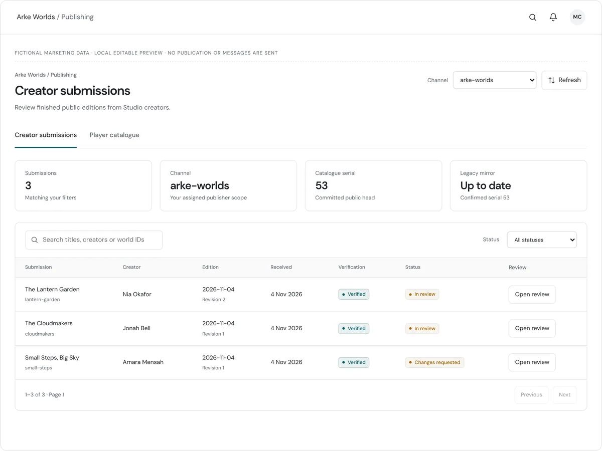
</picture>
<br><b>The editorial inbox.</b> Submissions for your channel, each already verified or
not.
</td>
<td width="50%" valign="top">
<picture>
  <source media="(prefers-color-scheme: dark)" srcset=".github/assets/readme-publishing-history-dark.webp">
  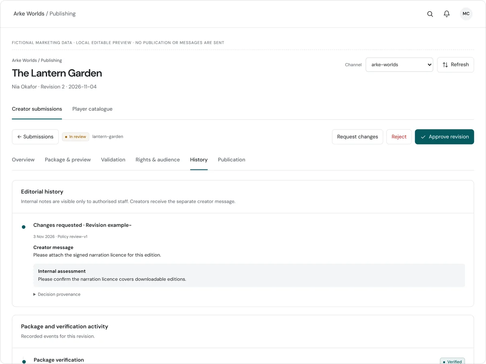
</picture>
<br><b>Every decision is kept.</b> What was asked of the creator, and the internal note
they never see.
</td>
</tr>
<tr>
<td width="50%" valign="top">
<picture>
  <source media="(prefers-color-scheme: dark)" srcset=".github/assets/readme-publishing-publish-dark.webp">
  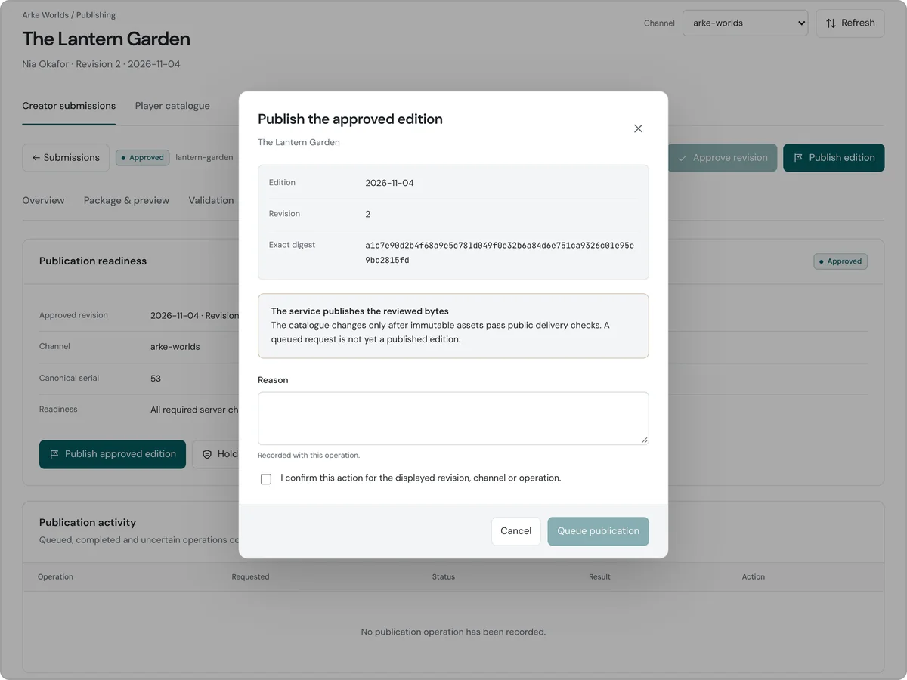
</picture>
<br><b>Publication is confirmed, then checked.</b> The catalogue changes only after the
immutable assets pass public delivery checks.
</td>
<td width="50%" valign="top">
<picture>
  <source media="(prefers-color-scheme: dark)" srcset=".github/assets/readme-publishing-catalogue-dark.webp">
  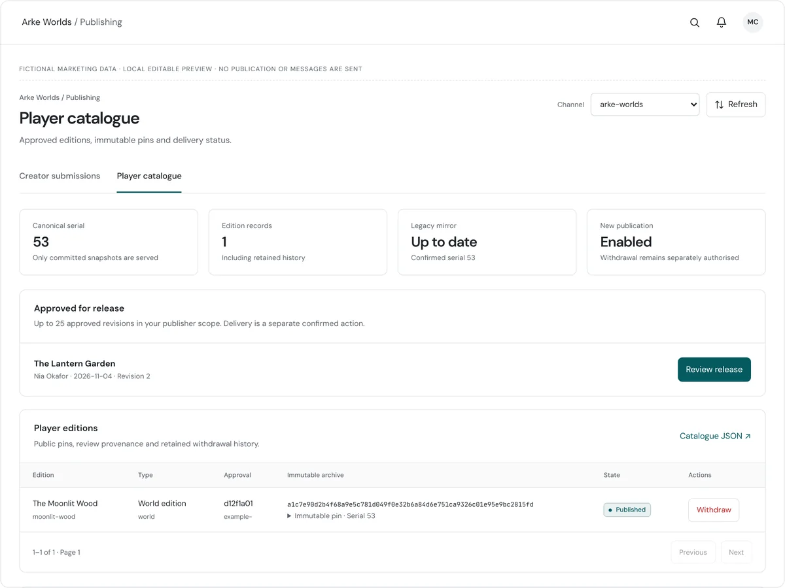
</picture>
<br><b>The Player catalogue.</b> What readers can discover, pinned to the archive it was
published from.
</td>
</tr>
</table>

Around it sit three platform primitives the Arke Worlds pack switches on:
**Subscriptions** (plans, entitlements, metered usage and signed entitlement tokens),
**Workspaces** (versioned file trees a studio can sync) and **Groups** (households and
sharing grants). See [Spec 100](docs/specifications/100.arke-player-publishing.html).

## Voice

`WSS /ai/voice` carries speech in and speech out, with the same gated agents in between. A
recipe is the pipeline: listen, transcribe, agent, speak, or one realtime model doing all four.

<div align="center">

<picture>
  <source media="(prefers-color-scheme: dark)" srcset=".github/assets/readme-voice-recipes-dark.webp">
  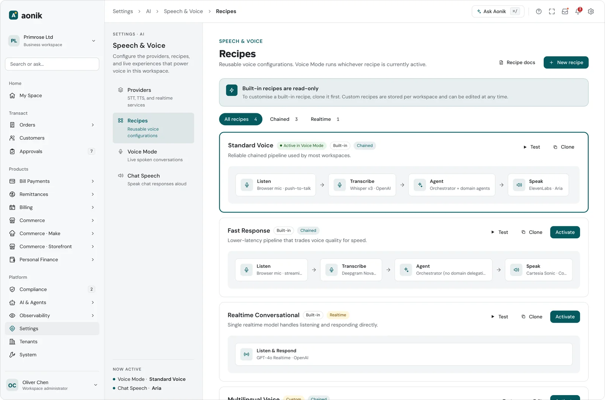
</picture>

*A recipe is a pipeline you can read: who listens, who transcribes, which agent answers and
whose voice speaks.*

</div>

<table>
<tr>
<td width="50%" valign="top">
<picture>
  <source media="(prefers-color-scheme: dark)" srcset=".github/assets/readme-voice-providers-dark.webp">
  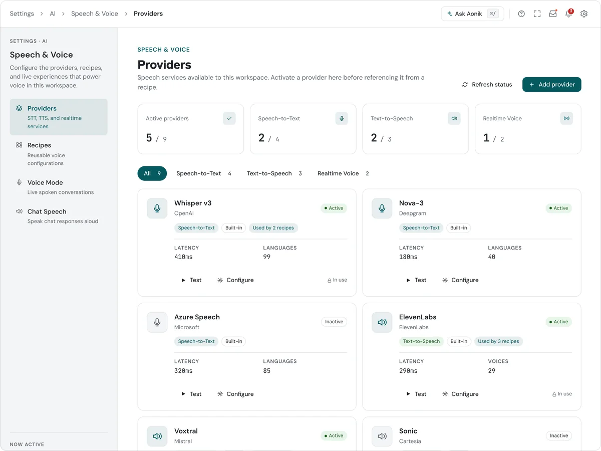
</picture>
<br><b>Providers per workspace.</b> Speech-to-text, text-to-speech and realtime, each
tested before a recipe relies on it.
</td>
<td width="50%" valign="top">
<picture>
  <source media="(prefers-color-scheme: dark)" srcset=".github/assets/readme-voice-mode-dark.webp">
  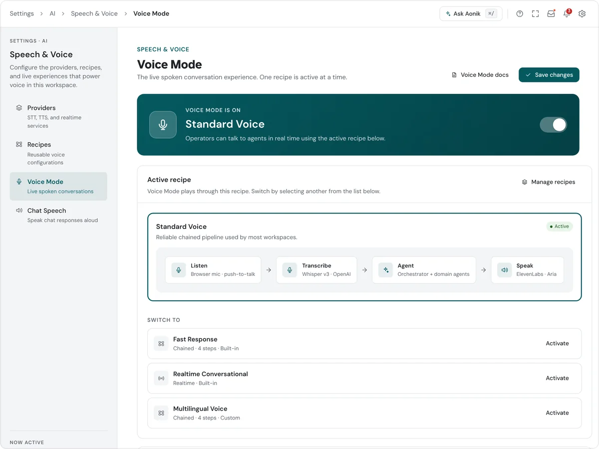
</picture>
<br><b>Voice mode.</b> One recipe is live at a time. Switching is a single action.
</td>
</tr>
</table>

Speech-to-text runs on OpenAI or Azure. Text-to-speech runs on OpenAI, Azure, ElevenLabs or
Mistral. Realtime runs on OpenAI Realtime or Azure Voice Live. A voice session cannot show
you the exact arguments of an action, so it does not ask you to approve one by ear: it hands
you a link to the request on the approvals page.

## See what happened

Every request carries a trace through the API, the agents, the tools and the Worker.
OpenTelemetry exports to the Aspire dashboard, Azure Monitor or Langfuse, and the Admin UI
reads the same data back.

<div align="center">

<picture>
  <source media="(prefers-color-scheme: dark)" srcset=".github/assets/readme-traces-dark.webp">
  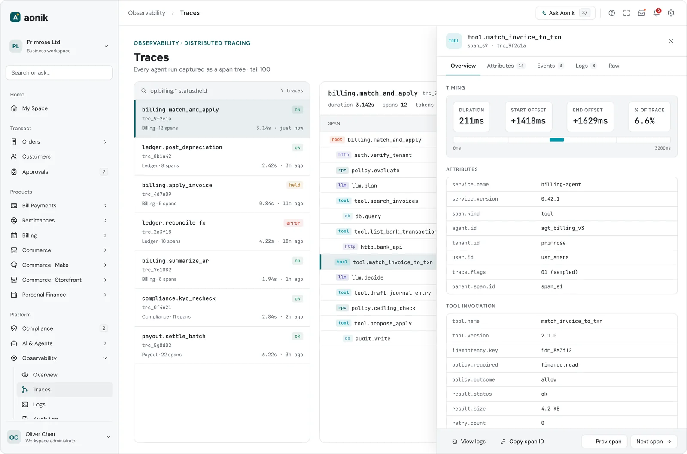
</picture>

*One agent run as a tree of spans: the policy check, the model's plan, each tool call and
the audit write.*

</div>

<table>
<tr>
<td width="50%" valign="top">
<picture>
  <source media="(prefers-color-scheme: dark)" srcset=".github/assets/readme-obs-overview-dark.webp">
  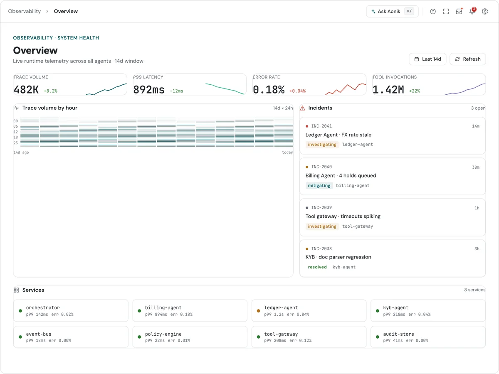
</picture>
<br><b>System health.</b> Volume, latency and errors across agents and services, with the
incidents that are open.
</td>
<td width="50%" valign="top">
<picture>
  <source media="(prefers-color-scheme: dark)" srcset=".github/assets/readme-logs-dark.webp">
  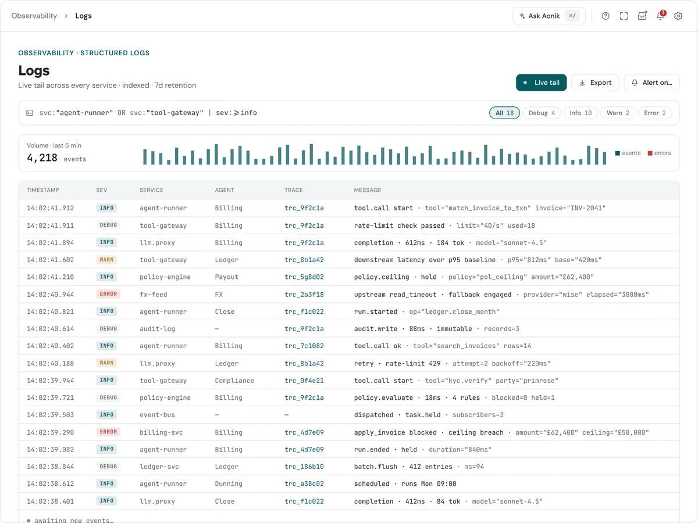
</picture>
<br><b>Logs.</b> Structured, filterable and tied to the trace they belong to.
</td>
</tr>
<tr>
<td width="50%" valign="top">
<picture>
  <source media="(prefers-color-scheme: dark)" srcset=".github/assets/readme-audit-dark.webp">
  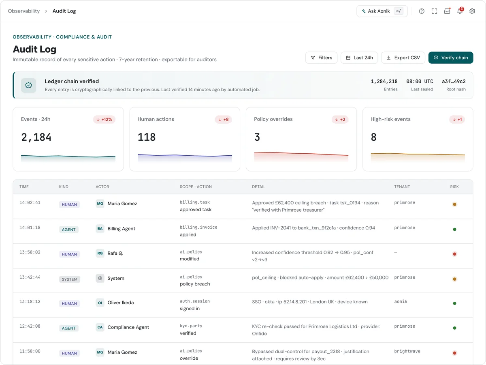
</picture>
<br><b>Audit.</b> People, agents and the system in one record of who did what.
</td>
<td width="50%" valign="top">
<picture>
  <source media="(prefers-color-scheme: dark)" srcset=".github/assets/readme-workers-dark.webp">
  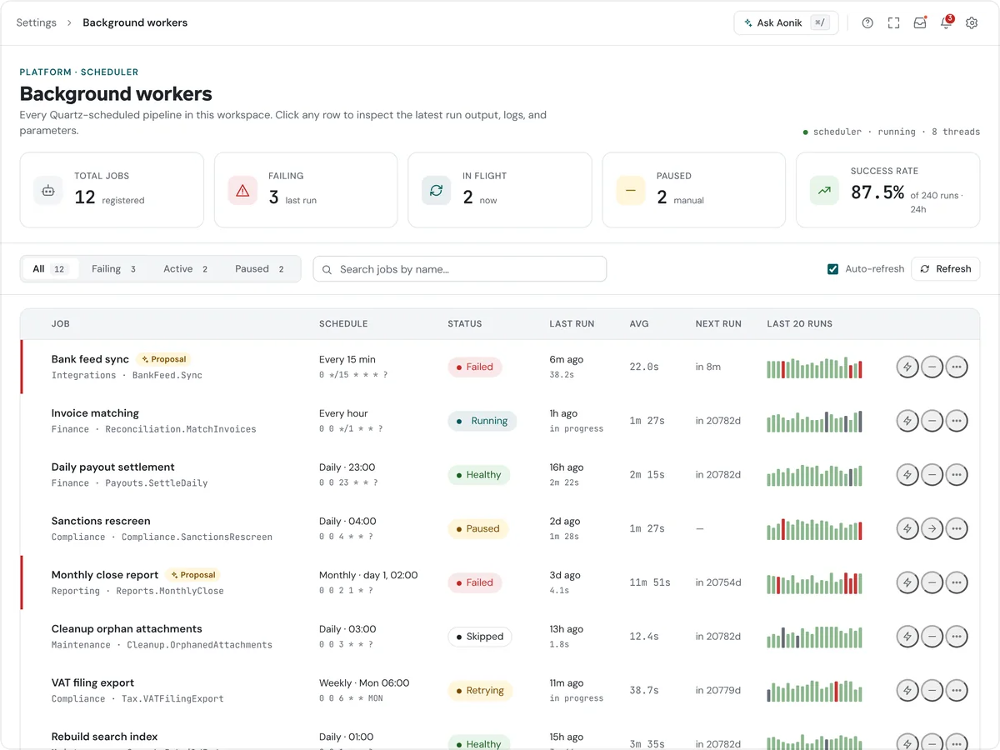
</picture>
<br><b>Background workers.</b> Every scheduled job with its history, and controls to
pause, resume or run it now.
</td>
</tr>
</table>

## Run the platform

Operating AONIK happens in the same Admin UI: settings, providers, people and tenants.

<table>
<tr>
<td width="50%" valign="top">
<picture>
  <source media="(prefers-color-scheme: dark)" srcset=".github/assets/readme-settings-dark.webp">
  
</picture>
<br><b>Settings.</b> Global defaults, workspace overrides and personal preferences in one
searchable place.
</td>
<td width="50%" valign="top">
<picture>
  <source media="(prefers-color-scheme: dark)" srcset=".github/assets/readme-gateways-dark.webp">
  
</picture>
<br><b>Payment gateways.</b> Credentials, webhooks and routing per provider.
</td>
</tr>
<tr>
<td width="50%" valign="top">
<picture>
  <source media="(prefers-color-scheme: dark)" srcset=".github/assets/readme-users-dark.webp">
  
</picture>
<br><b>People and access.</b> Invite, assign roles, revoke sessions, suspend and delete,
with a tombstone kept for the audit trail.
</td>
<td width="50%" valign="top">
<picture>
  <source media="(prefers-color-scheme: dark)" srcset=".github/assets/readme-tenants-dark.webp">
  
</picture>
<br><b>Tenants.</b> A host administrator provisions and suspends workspaces. Everyone else
sees only their own.
</td>
</tr>
</table>

Sign-in is your choice of **Auth0**, **Microsoft Entra ID** or **Keycloak**, selected once
per deployment. Tokens from any registered issuer validate side by side, so switching
provider does not break sessions in flight. The Admin UI also runs as a desktop app
(Electron), and a [CLI](docs/guides/aonik-cli.md) covers agents, approvals, orders, payments,
jobs and packs for people and for agent harnesses.

## Payabo

Payabo is the consumer product on the personal-finance modules: accounts and transactions,
bills and budgets, a plan, money sent home, and Simi, a companion you can type to or talk to.

<div align="center">


*Home, Pay, Plan, Spend and Simi. The phone is one more client of the same platform.*

</div>

The web app is in [`apps/Payabo`](apps/Payabo) and the Flutter app in
[`apps/payabo_mobile`](apps/payabo_mobile). Behind them, `Aonik.PersonalFinance` holds
households, linked accounts through Plaid, statement import, transaction classification,
bills, budgets, commitments and the
[financial life graph](docs/features/financial-life-graph.md) the agents read from.

## On the drawing board

Some of the drawings are ahead of the code. Customer support is the clearest example: an
email inbox where AONIK drafts a grounded reply and a person sends it. It is designed and not
built. No mailbox or support API is connected to it yet.

<table>
<tr>
<td width="50%" valign="top">
<picture>
  <source media="(prefers-color-scheme: dark)" srcset=".github/assets/readme-support-inbox-dark.webp">
  
</picture>
<br><b>Design: a support inbox.</b> Every conversation with the customer's records and a
suggested next step beside it.
</td>
<td width="50%" valign="top">
<picture>
  <source media="(prefers-color-scheme: dark)" srcset=".github/assets/readme-support-reply-dark.webp">
  
</picture>
<br><b>Design: a reply you review.</b> A draft grounded in named sources, with the facts to
check before a person sends it.
</td>
</tr>
</table>

## One platform, many products

A business type is a pack: a JSON manifest of modules, settings, agent overrides and
reference data, applied when a tenant is provisioned.

| Pack | Switches on | For |
|---|---|---|
| `base` | The core platform, no optional modules | A general business workspace |
| `remittance` | Finance, Documents, AI, Agents | Transfer orders, corridors, partners, FX, ledger, compliance |
| `food-commerce` | Commerce, AI, Agents, with Finance and Ordering as dependencies | A kitchen that sells online |
| `simi` | Personal Finance, Groups, Documents, AI, Agents, Voice | A consumer money companion |
| `arke-worlds` | Publishing, Workspaces, Groups, Subscriptions, Finance, Documents, AI, Agents | A studio's publishing, subscriptions and families |

The Admin UI has a profile for each, which decides the landing page, the navigation and the
words on it. See [ADR-013](docs/decisions/013-product-identity-is-configuration.md) and
[ADR-014](docs/decisions/014-business-type-configuration-packs.md).

## What's in the box

Thirteen modules on a shared kernel, behind one API: more than 800 HTTP endpoints, 213
entity sets in a single migration stream, about 4,400 backend tests and 600 Admin UI tests.

| Module | Owns |
|---|---|
| `Aonik.SharedKernel` | Primitives, cross-module contracts, integration events and the approval gate |
| `Aonik.Platform` | Tenancy, identity, parties, compliance, notifications, settings, content, tasks and the platform side of connectors |
| `Aonik.Ordering` | The order spine: orders, items, history, funding and fulfilment references |
| `Aonik.Finance` | Ledger, billing, payments, pricing and FX, partners, catalogue, remittance, gift cards and loyalty |
| `Aonik.Commerce` | Catalogue, cart, checkout, fulfilment, inventory, production, promotions and sourcing |
| `Aonik.Subscriptions` | Plans, entitlements and metered usage |
| `Aonik.PersonalFinance` | Accounts, transactions, bills, budgets, households' money, the life graph and insights |
| `Aonik.Groups` | Groups, members, sharing grants and invitations |
| `Aonik.Documents` | Documents, versions, links, extraction and ingestion for retrieval |
| `Aonik.Workspaces` | Versioned file trees, content-addressed blobs and sync |
| `Aonik.Publishing` | Submissions, editorial review, editions, channels and the catalogue |
| `Aonik.Ai` | Model catalogue and routing, prompts, `AiRun`, memory and content safety |
| `Aonik.Agents` | The agent runtime, orchestration, proposals, tool approvals, workflows, rooms and extensions |
| `Aonik.Voice` | The real-time voice pipeline and speech settings |

An agent's memory of a user is kept in SQL Server or Qdrant, chosen in settings. Documents
are chunked, embedded and indexed in Qdrant by the Worker, scoped to the party that owns
them, so an agent retrieves only what its user may see.

## Principles

**People and agents are one team.** Agents carry the routine and the constant. People bring
judgement, relationships and accountability. Neither works out of sight of the other: every
author in a conversation is named, and everything an agent does can be traced.

**Agents propose. Systems apply. Humans stay in control.** An agent may reason, plan and
draft as boldly as it likes. It cannot quietly change a balance, send a payment or publish a
book.

**Risk decides autonomy.** Reversible personal writes run with a record. Everyday business
writes ask once. Money, the ledger and anything that leaves the building wait for a
proposal to be approved.

**Every AI action leaves a record.** A model call is an `AiRun`. An approval, a proposal and
a workflow step each point back to the run that caused them. A workspace can stop its agents
with one switch.

**The ledger is the truth.** Double-entry and immutable. Corrections are new entries.

**A product is a configuration.** New products arrive as packs and profiles. Platform code
names functions, never brands.

## How this is built

AONIK is a module-first modular monolith on .NET 10. Each module owns its vertical slice
(entities, services, endpoints, persistence configuration) and a module-scoped `DbContext`
over one shared SQL Server database.


Modules talk through SharedKernel contracts and integration events. Finance and Commerce
meet only through Ordering. Publishing, Workspaces, Groups, Documents and Subscriptions
reference SharedKernel alone. Architecture tests guard the dependency direction and fail the
build when a guarded line is crossed. The rule is not yet absolute: Platform still references
Finance and PersonalFinance directly.

Schema changes go through one migration stream owned by `AonikDbContext`, and migrations are
generated by the EF Core tooling, never written by hand. Domain entities hold data only; the
logic lives in services.

AONIK is specified before it is written, and drawn before it is built. The repository
carries a hundred numbered [specifications](docs/specifications) and sixteen
[decision records](docs/decisions). The screens are drawn in a design kit,
[`Templates/aonik-admin-starterkit`](Templates/aonik-admin-starterkit), whose canvas holds
182 editable artboards in light and dark. **The screenshots in this README are rendered from
that kit**, and the phone screens from
[`Templates/payabo-mobile-starterkit`](Templates/payabo-mobile-starterkit): they are the
drawings the Admin UI is built against. The running app follows them closely, not pixel for
pixel. The companies, people, figures, model names and providers in them are sample data.
Where a drawing is ahead of the code, [Status](#status) says so.

| | |
|---|---|
| `src/Aonik.Api` | The HTTP composition root (FastEndpoints), with OpenAPI and a Scalar reference |
| `src/Aonik.Worker` | Background jobs on Quartz: outbox, work items, sync, sweeps and renewals |
| `src/Aonik.Infrastructure` | The migration stream and every external adapter |
| `src/Aonik.Migrator` | Applies migrations and seeds base data |
| `src/Aonik.AppHost` | .NET Aspire orchestration for local development |
| `src/Aonik.AdminUi` | The operator workspace: React 19, Vite 7, Tailwind CSS 4, Radix, Dockview |
| `src/Aonik.AdminDesktop` | The Electron shell around the Admin UI |
| `src/Aonik.Cli` | A headless client for operators and agent harnesses |
| `src/Aonik.Finance.Mcp` · `src/Aonik.Platform.Mcp` | MCP servers for local development |
| `packages/workspace-sdk` | Panels, context sharing and an iframe bridge for the multi-panel workspace |
| `apps/Payabo` · `apps/payabo_mobile` | The Payabo web app and Flutter app |
| `apps/docs-site` · `apps/website` | The documentation site (Next.js, Fumadocs) and the marketing site |
| `iac/azure` | Bicep for Azure Container Apps, SQL, Key Vault, storage and monitoring |
| `tools` | The Arke package verifier, its qualification runner and the release mirror |

| Layer | Stack |
|---|---|
| Runtime and API | .NET 10, FastEndpoints, EF Core 10, SQL Server |
| Agents | Microsoft Agent Framework, Microsoft.Extensions.AI, AG-UI, Model Context Protocol |
| Retrieval | Qdrant |
| Jobs and caching | Quartz.NET, FusionCache |
| Identity | Auth0, Microsoft Entra ID, Keycloak |
| Observability | OpenTelemetry, Azure Monitor, Langfuse |
| Admin UI | React 19, Vite 7, Tailwind CSS 4, Radix UI, Dockview, React Flow |
| Mobile | Flutter, Riverpod, Firebase, Plaid |
| Testing | xUnit, FluentAssertions, NetArchTest, Testcontainers, Vitest |
| Delivery | .NET Aspire, Docker, Bicep, GitHub Actions |

## Run from source

You need the [.NET 10 SDK](https://dotnet.microsoft.com/download/dotnet/10.0), Node 22,
Docker for Qdrant, and SQL Server. The Aspire host uses SQL Server LocalDB, which is
Windows-only; on other systems use the compose file below.

```bash
git clone https://github.com/michaeljosiah/aonik.git
cd aonik

# API, Worker, Admin UI, Payabo and Qdrant together
dotnet run --project src/Aonik.AppHost
```

| Service | URL |
|---|---|
| API | `https://localhost:5001` |
| API reference (Scalar) | `https://localhost:5001/scalar` |
| Admin UI | `http://localhost:5173` |
| Payabo | `http://localhost:5174` |
| Aspire dashboard | `https://localhost:17070` |

The host applies migrations and seeds base data on start. The first tenant and its owner are
created once through the bootstrap endpoint, and you need an identity provider to sign in:
Auth0 or Entra ID, or a local Keycloak that the host starts for you when
`AONIK_AUTH_PROVIDER=Keycloak` is set. The [getting started guide](docs/guides/getting-started.md)
walks through it, and on Windows `scripts/onboard.ps1` does it in one pass. Models default to
a stub provider, so the platform runs without a key; add an OpenAI key in settings for real
ones.

Without LocalDB, run SQL Server, the API, the Worker and Qdrant in containers. The API is
then at `http://localhost:8080`:

```bash
docker compose -f docker/compose.yml up --build
```

Or run the parts yourself:

```bash
dotnet build Aonik.sln
dotnet run --project src/Aonik.Migrator          # migrations and base data
dotnet run --project src/Aonik.Api
cd src/Aonik.AdminUi && npm install && npm run dev
```

Tests:

```bash
dotnet test Aonik.sln
dotnet test tests/Aonik.Application.Tests
dotnet test --filter "DisplayName~CreateInvoice"
cd src/Aonik.AdminUi && npm test
```

Most backend tests use the in-memory provider. `tests/Aonik.Database.Tests` runs against
SQL Server LocalDB and `tests/Aonik.Finance.IntegrationTests` applies the real migration
stream in Docker, for the behaviour an in-memory database cannot fail on.

To open the design kit, serve it and browse to the canvas:

```bash
cd Templates/aonik-admin-starterkit
python -m http.server 4173 --bind 127.0.0.1      # then open http://127.0.0.1:4173/index.html
```

## Status

AONIK is in active development. APIs and the data model still change.

**The governed core is built.** Tenancy, three identity providers, parties and compliance,
the order spine, the ledger, billing and payments, the fail-closed approval gate, proposals
and their dispatcher, and an `AiRun` for every model call.

**Finance and remittance run end to end in the Admin UI.** Orders, transfers,
beneficiaries, receipts, invoices, the ledger, FX rates and the partner network. Partner
connectors exist for Flutterwave payouts and bills and for Stripe Checkout, with Plaid for
bank links. Other provider names in the drawings are sample data.

**Workflows, decisions and connectors are built and gated.** Execution is off until a
workspace enables it. Live qualification of Gmail push delivery is still open.

**Agents run on OpenAI today,** with a stub provider for development without a key. Azure
OpenAI is named in configuration and not implemented. Route policies choose a model per use
case; cost ceilings and automatic fallback are decided
([ADR-012](docs/decisions/012-ai-route-policy-cost-governance.md)) and not built.

**One authorised person decides an approval.** Chains of several approvers and separation
of duties are drawn and not built. AI policy records can be edited, but what is enforced at
run time is the approval gate and the kill switch. Feedback and evaluation suites exist as
tables only. The audit log is a record, not yet a hash chain.

**Commerce is built behind the API,** and its orders, packing, menu, box plan, delivery and
storefront screens are in the Admin UI. The kitchen, stock and margin screens are drawn
against production, sourcing, inventory and reporting APIs that exist; the screens
themselves are not built.

**Publishing is qualified end to end in the development environment** with Arke Studio and
Arke Player, including large packages, withdrawal and offline retention. The production
cutover has not happened. The Arke Worlds screens beyond publishing are drawn, and in the app
they report what is connected instead of showing live data.

**The customer foundation is a record and its channels, not yet a full CRM.** Customers,
consent, enquiries, sign-up lists, content, templates, discounts, gift cards and loyalty are
built. Sales pipelines, segments and campaigns are not.

**Voice is built:** the WebSocket pipeline, provider and recipe settings, and approval
hand-off to the Admin UI.

**Payabo's clients are in this repository** as a web app and a Flutter app. Treat both as
work in progress.

**Customer support is a design.** No mailbox or support API sits behind those screens.

**The MCP servers are for local development only,** and refuse to start anywhere else.

## Documentation

| | |
|---|---|
| [Architecture](docs/architecture.html) · [Agents](docs/agents.html) · [Database](docs/database.html) | How the platform is put together |
| [Decision records](docs/decisions) | Sixteen ADRs, from the modular monolith to workspaces |
| [Specifications](docs/specifications) | The numbered specs each capability was built from |
| [Feature guides](docs/features) | Ledger, billing, payments, pricing, chat, remittance, the life graph and more |
| [Guides](docs/guides) | Getting started, authentication, migrations, testing, the CLI |
| [Deployment](docs/deployment) · [`iac/azure`](iac/azure/README.md) | Local development, Docker, Azure and Keycloak hosting |
| [Runbooks](docs/runbooks) | Operating workflows, publishing and connectors |
| [Design kit](Templates/aonik-admin-starterkit/README.md) | The canvas, the tokens and the screenshot gallery |
| [CHANGELOG](CHANGELOG.md) | What changed, in detail |
| [CLAUDE.md](CLAUDE.md) · [AGENTS.md](AGENTS.md) | The rules for people and agents working in this codebase |

## Contributing

Contributions are welcome. Expect refactors and breaking changes while the platform settles.

Before you open a pull request: `dotnet build Aonik.sln` succeeds, `dotnet test Aonik.sln`
passes, the change follows [CLAUDE.md](CLAUDE.md), and [CHANGELOG.md](CHANGELOG.md) says what
you did. Schema changes are generated with `dotnet ef migrations add` against
`AonikDbContext`; a hand-written migration will be turned away. The
[contributing guides](docs/contributing) cover code style, the git workflow and pull
requests.

## Licence

AONIK is source-available under the [AONIK Non-Commercial Source License](LICENSE). You may
use, study, modify and share it for non-commercial purposes. Commercial use, including
offering it as a hosted service, needs a separate written licence from the AONIK
maintainers.

---

<div align="center">

**Agents propose. Systems apply. Humans stay in control.**

</div>
